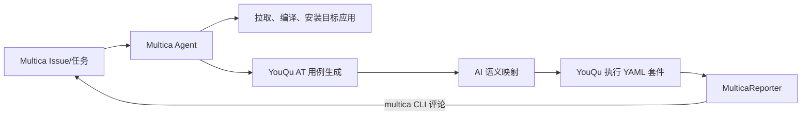

# youqu-ai 与 multica 配合

- 会话 ID: `01a08542-450e`
- 类型: 顶层会话
- 项目目录: `/home/ut000635@uos/Documents/TestCode/youqu-ai`
- 创建时间: 2026-09-09T16:21:47+08:00
- 最后活动: 2026-09-11T14:56:02+08:00
- 消息: 用户提示词 1 / 助手文本 3 / 模型请求 6
- 模型: gpt-5.6-sol × 6
- Token: input=330,873, output=2,245, cacheRead=0, total=333,118
- 工具调用 Top: read×13, grep×2
- 原始记录: `/home/ut000635@uos/.omp/agent/sessions/-Documents-TestCode-youqu-ai/2026-09-09T08-21-47-918Z_01a08542-450e-70ce-b139-b318967a888c.jsonl`

## 用户提示词

### U1

当前项目与multica是怎么配合使用的？

## 助手输出（按时间顺序，已省略 thinking 与工具参数）

### A1

我先核对仓库中的 Multica 集成设计和实际代码入口，区分“已实现能力”与“规划中的协作方式”。

### A2

我先核对设计文档与实际 CLI/报告器实现，区分“已经可用的集成”与“仅文档约定的流程”。

### A3

\## 结论

当前 YouQu 与 Multica 是**“Multica 负责调度，YouQu 负责生成和执行自动化测试，通过 Multica CLI 回写进度与结果”**的关系。不是 SDK/API 深度耦合，也不是 Multica 直接执行底层 AT-SPI 操作。



\## 两种主要配合方式

\### 1. Multica 调度已有 YouQu 测试

这是目前最完整的集成路径。

Multica Agent 从 issue 中取得：

- 应用名、包名、二进制路径
- 测试模式：增量、自测、全量
- 测试目录或指定模块
- Multica Issue ID
- 心跳间隔

然后执行：

```bash
youqu at run \
  --testdir tests/at/yaml/ \
  --multica-report \
  --issue-id MUL-123 \
  --app deepin-music \
  --report-interval 300
```

对应入口：

- 参数定义：`cli/main.py:281-296`
- 执行接线：`cli/at.py:453-489`
- Multica 上报实现：`cli/multica.py:236-379`

`run_tests()` 通过两个回调接入 `MulticaReporter`：

```python
on_start=reporter.start
on_suite_done=reporter.on_suite_complete
```

上报时机：

1. 测试启动时发送开始评论。
2. 每完成一个 suite 发送进度评论。
3. 单个 suite 长时间没有结束时，默认每 300 秒发送心跳。
4. 全部结束后发送通过数、失败数、跳过数、通过率和耗时。

这样主要是为了避免 Multica 将长时间没有输出的任务判定为 30 分钟超时。

实际写回方式是调用本机 Multica CLI：

```bash
multica issue comment add <ISSUE_ID> --content <内容>
```

前置条件：

- 已安装 `multica` 命令。
- 存在 `~/.multica/config.json` 认证配置。

如果缺少命令、配置或评论发送失败，代码只输出警告，**不会中断 YouQu 测试**。

应用版本不执行可能卡住的 `<app> --version`，而是通过：

```text
dpkg -S <二进制> → apt policy <包名>
```

相关实现位于 `cli/multica.py:33-109`。

\### 2. 在 Multica 中生成新的 AT-SPI YAML 用例

项目提供了独立入口：

```bash
youqu multica-agent pipeline \
  --app deepin-music \

…（截断，原文 3453 字符）
