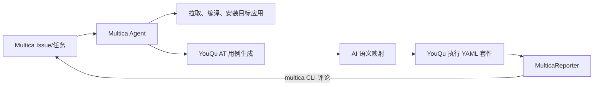

# youqu-ai 与 multica 配合

- 会话 ID: `01a08542-450e`
- 项目目录: `/home/ut000635@uos/Documents/TestCode/youqu-ai`
- 创建时间: 2026-09-09T08:21:47.918Z
- 消息: user 1 / assistant 3
- 模型: gpt-5.6-sol × 6
- Token: input=330873, output=2245, cacheRead=0, total=333118
- 工具调用 Top: read×13, grep×2
- 原始记录: `/home/ut000635@uos/.omp/agent/sessions/-Documents-TestCode-youqu-ai/2026-09-09T08-21-47-918Z_01a08542-450e-70ce-b139-b318967a888c.jsonl`

## 用户提示词

### U1

当前项目与multica是怎么配合使用的？

## 助手输出（按时间顺序，已省略 thinking 与工具参数）

### A1

我先核对仓库中的 Multica 集成设计和实际代码入口，区分“已实现能力”与“规划中的协作方式”。

### A2

我先核对设计文档与实际 CLI/报告器实现，区分“已经可用的集成”与“仅文档约定的流程”。

### A3

## 结论

当前 YouQu 与 Multica 是**“Multica 负责调度，YouQu 负责生成和执行自动化测试，通过 Multica CLI 回写进度与结果”**的关系。不是 SDK/API 深度耦合，也不是 Multica 直接执行底层 AT-SPI 操作。



## 两种主要配合方式

### 1. Multica 调度已有 YouQu 测试

这是目前最完整的集成路径。

Multica Agent 从 issue 中取得：

- 应用名、包名、二进制路径
- 测试模式：增量、自测、全量
- 测试目录或指定模块
- Multica Issue ID
- 心跳间隔

然后执行：

```bash
youqu at run \
  --testdir tests/at/yaml/ \
  --multica-report \
  --issue-id MUL-123 \
  --app deepin-music \
  --report-interval 300
```

对应入口：

- 参数定义：`cli/main.py:281-296`
- 执行接线：`cli/at.py:453-489`
- Multica 上报实现：`cli/multica.py:236-379`

`run_tests()` 通过两个回调接入 `MulticaReporter`：

```python
on_start=reporter.start
on_suite_done=reporter.on_suite_complete
```

上报时机：

1. 测试启动时发送开始评论。
2. 每完成一个 suite 发送进度评论。
3. 单个 suite 长时间没有结束时，默认每 300 秒发送心跳。
4. 全部结束后发送通过数、失败数、跳过数、通过率和耗时。

这样主要是为了避免 Multica 将长时间没有输出的任务判定为 30 分钟超时。

实际写回方式是调用本机 Multica CLI：

```bash
multica issue comment add <ISSUE_ID> --content <内容>
```

前置条件：

- 已安装 `multica` 命令。
- 存在 `~/.multica/config.json` 认证配置。

如果缺少命令、配置或评论发送失败，代码只输出警告，**不会中断 YouQu 测试**。

应用版本不执行可能卡住的 `<app> --version`，而是通过：

```text
dpkg -S <二进制> → apt policy <包名>
```

相关实现位于 `cli/multica.py:33-109`。

### 2. 在 Multica 中生成新的 AT-SPI YAML 用例

项目提供了独立入口：

```bash
youqu multica-agent pipeline \
  --app deepin-music \
  --binary /usr/bin/deepin-music \
  --package deepin-music \
  --src /path/to/deepin-music \
  --cases cases.xlsx \
  --issue-id MUL-123
```

入口及流程：

- CLI 参数：`cli/main.py:107-142`
- 管线实现：`cli/multica_agent.py:612-739`

管线为：

```text
源码扫描
  → 运行时 AT-SPI dump
  → 静态/运行时元素合并
  → xlsx/csv 转 cases_raw.yaml
  → AI 语义映射
  → 生成可执行 suite YAML
  → 执行测试
```

关键产物默认放在：

```text
tests/at/
├── at-tree.yaml
├── cases_raw.yaml
├── cases_mapped.yaml
├── suite-cases.yaml
├── agent.log
└── yaml/
    └── *.suite.yaml
```

其中有一个明确边界：`multica-agent` **不负责用脚本猜测语义映射**。AI Agent 必须阅读 AT 元树和用例描述，按照 `at-case-generator` 规则生成 `cases_mapped.yaml`。

首次运行如果只有原始用例，管线会返回：

```text
status: need_ai_mapping
```

AI 完成 `cases_mapped.yaml` 后，再执行：

```bash
youqu multica-agent pipeline \
  --app deepin-music \
  --cases tests/at/cases_raw.yaml \
  --skip-mapping
```

无图形环境时可以使用：

```bash
--no-display
```

此时跳过运行时 AT-SPI dump，依据源码扫描产物合成 `at-tree`。但这只能提供静态元素信息，无法等价替代真实桌面环境下的可寻址性验证。

## Multica 侧约定

`docs/提示词/multica-at-agent-prompt.md` 定义了 Multica Agent 的完整职责：

- **增量测试**：分析代码变更，只执行相关模块。
- **自测**：研发或 issue 触发，流程基本等同增量测试。
- **全量测试**：安装最新软件包，执行全部套件。
- 必须通过 `youqu at run` 执行，不能直接调用 pytest。
- 必须清理目标应用进程和临时工作区。
- 长任务必须启用 `--multica-report`。
- 完整报告、覆盖率等大文件通过 `multica attachment upload` 上传；摘要写入 issue 评论。

因此职责边界是：

| 组件 | 职责 |
|---|---|
| Multica | Issue、任务触发、Agent 编排、仓库和运行环境、结果承载 |
| YouQu CLI | AT 元素采集、YAML 用例生成、验证和执行 |
| AI Agent/技能 | 理解自然语言步骤并映射到 AT-SPI selector/action |
| `MulticaReporter` | 将 YouQu 执行进度回写 Multica issue |

## 当前实现中的一个缺口

`youqu at run --multica-report` 的上报链路是完整的；但 `youqu multica-agent pipeline --issue-id ...` 中，`MulticaReporter` 只被初始化，并没有调用 `reporter.start()`：

- 初始化：`cli/multica_agent.py:121-140`
- 最终调用：`cli/multica_agent.py:147-150`
- 管线结束：`cli/multica_agent.py:734-736`

因此该管线目前不会真正启动定时心跳和 suite 统计，而且直接 `finish()` 时开始时间仍是初始值。实际长期执行任务应以：

```bash
youqu at run --multica-report ...
```

作为可靠的 Multica 进度上报入口。换言之，**测试执行上报已接通；一键生成管线自身的心跳上报仍未完整接通。**
