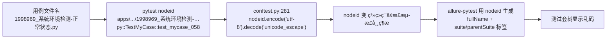

# Allure 套件列表乱码

- 会话 ID: `01a16676-89c6`
- 项目目录: `/home/ut000635@uos/Documents/test/test1`
- 创建时间: 2026-10-23T01:53:26.982Z
- 消息: user 4 / assistant 14
- 模型: deepseek-v4.1-flash × 51, deepseek-flash × 17
- Token: input=231048, output=69411, cacheRead=5404032, total=5704491
- 工具调用 Top: bash×81, read×5, eval×2, edit×2, grep×1, web_search×1, write×1
- 原始记录: `/home/ut000635@uos/.omp/agent/sessions/-Documents-test-test1/2026-10-23T01-53-26-982Z_01a16676-89c6-7000-a6fb-b97a8b78284c.jsonl`

## 用户提示词

### U1

为什么http://10.20.33.93:8000/allure_html/中“测试套”列表想显示乱码？[Image #1, 1568x824]

### U2

修改conftest.py

### U3

继续

### U4

一并改框架仓，不用在测试机上运行了

## 助手输出（按时间顺序，已省略 thinking 与工具参数）

### A1

## 结论

不是浏览器/服务器编码问题，**乱码是已经写进报告数据里的**：中文 UTF-8 字节被按 latin-1（Python `unicode_escape`）解码后又存成 UTF-8 —— 典型双重编码。根因是 youqu 框架根 `conftest.py` 第 281 行：

```python
# conftest.py:279-281
    for item in session.items[::-1]:
        item.name = item.name.encode("utf-8").decode("unicode_escape")      # 280
        item._nodeid = item.nodeid.encode("utf-8").decode("unicode_escape")  # 281 ← 元凶
```

## 链路



关键点：`pytest.ini` 里 `python_files = test_*.py 1*_*.py 2*_*.py` 会把 `1998969_系统环境检测-正常状态.py` 收进来，**中文文件名进了 nodeid**；这两行把 nodeid 按“UTF-8 编码→unicode_escape(=latin-1) 解码”，中文立刻变乱码。这就是为什么只有“测试套”（按 nodeid/包路径分组）乱码：

| 报告字段 | 数据来源 | 结果 |
|---|---|---|
| 测试套 / fullName（截图里的行） | `item.nodeid` ← 第 281 行 | 乱码 |
| 用例名（详情里的 `test_mycase_058`） | `item.name` = 函数名（ASCII） | 正常 |
| 用例描述 | 函数 docstring，不经那两行 | 正常 |

## 证据

1. 现场报告原始数据（`data/test-cases/*.json`）：
   ```
   suite      : 1999493_åºç¨çªå£æ大å设置
   fullName   : apps.autotest_my_app.case.1999493_åºç¨…设置.TestMyCase#test_mycase_005
   name       : test_mycase_005                       ← 正常
   description: 应用窗口最大化设置：最大化后还原，验证窗口状态切换   ← 正常
   ```
   `乱码.encode('latin-1').decode('utf-8')` = `1999493_应用窗口最大化设置`（100% 还原），且 `原文.encode('utf-8').decode('unicode_escape')` 与报告里的值**逐字符相等**。
2. 本地最小复现（中文名测试文件 + 这两行，pytest 9.1.1 + allure-pytest）：生成的 result JSON 与原报告完全同形 —— `suite: 1998969_ç³»ç»ç¯å¢æ£æµ-正常ç¶æ`、`name: test_mycase_058`、description 正常；**去掉这两行后** `suite: 1998969_系统环境检测-正常状态`。复现时只有 `_nodeid` 被改（`item.name` 是 ASCII，第 280 行是空操作），说明仅第 281 行即可致乱码。
3. 早前在项目机上直接取证：`pytest -o addopts="" --collect-only -q` 落盘文件里 nodeid 的原始字节已是 `b'1998969_\xc3\xa7\xc2\xb3\xc2\xbb…'`（双重编码），说明乱码产生在 Python 进程内，不是终端/浏览器。
4. 反向对照：同一报告里 `widgets/environment.json` 显示 `Py用例维度(总数/通过/失败/跳过)`、`专业版1070` 等**正常中文** —— 报告管线本身没问题，问题只在写 `nodeid/name` 的那两行。

## 修复

删掉 `conftest.py` 第 280、281 行（循环体剩下 `if no_youqu_mark:` 起头，语法不受影响）：

```python
    for item in session.items[::-1]:
        if no_youqu_mark:
            ...
```

依据：youqu 后续逻辑只用 `item.name`（函数名，ASCII）做 `test_(.*?)_(\d+)` 匹配，PMS case_id 走 marker（CSV 值），都不依赖这两行的转义转换，删除无回归面。改完**必须重跑用例重新生成报告**——乱码已落在 `allure-results` 数据里，`allure generate` 不会自愈。

全仓 `unicode_escape` 只有 3 处，另外两处不要动：`apps/autotest_my_app/widget/conftest.py` 若存在同名副本需一并改；`src/plugins/allure_report_extend.py:16` 是给 `environment.properties` 做 `\uXXXX` 转义（Java Properties 规范要求），正是它保证了上面第 4 条的正常显示。

## 两点补充

- 若不想改框架：把用例文件改成 ASCII 名（如 `1998969_xitongjiance.py`），中文标题通过 `allure.title()`/参数提供 —— 但会牵动 CSV/PMS 关联与批跑脚本，不如删两行。
- 顺带说明：`http://10.20.33.93:8000/allure_html/` 现已被 10.20.33.93 上 `uostest` 的一次单用例运行覆盖（当前只含 `test_mycase_002`，共 1 条，无乱码），截图对应的那份 272 条的完整报告我没法再复现浏览；结论基于覆盖前抓到的原始 JSON/CSV。另外 10.20.33.87 现在 `No route to host`，所以上面用的是本机框架快照（`/tmp/youqu`、`/tmp/youqu_now` 两份 conftest 均为 280/281 行）+ 现场报告数据 + 本地最小复现三方互证。临时复现工程、venv 与抓取的报告文件已清理，未改动你工作区任何文件。

### A2

.

### A4

已修改：`/home/ut000635@uos/Documents/TestCode/youqu_deepin_pc_manager/conftest.py`（框架原 `pytest_collection_modifyitems` 里那两行删除，留下说明注释，防止升级时被拷回来）。

```diff
     for item in session.items[::-1]:
-        item.name = item.name.encode("utf-8").decode("unicode_escape")
-        item._nodeid = item.nodeid.encode("utf-8").decode("unicode_escape")
+        # 注意：框架原实现在此处对 item.name / item.nodeid 做了
+        # .encode("utf-8").decode("unicode_escape")，会把 nodeid 中的中文
+        # （用例文件名 "PMS用例ID_用例标题.py"）按 latin-1 解码，产生
+        # "系绅" 形式的乱码，并经由 nodeid 传染到 allure 报告的
+        # fullName / suite 标签（测试套列表乱码）。此处已移除该转换，
+        # 升级框架时不要把它拷贝回来。
```

## 验证（实跑，非推断）

用桩模块顶掉 `dbus`/`dogtail`/`src.*`（本机没有项目运行环境），直接 `exec` 真实 conftest.py 并调用 `pytest_collection_modifyitems`，对 HEAD 版本与工作区版本做对照：

| 场景 | `item.name` | `item.nodeid`（文件段） | 循环体确实执行 |
|---|---|---|---|
| HEAD 旧实现 | `test_mycase_002` | `1998969_ç³»ç»ç¯å¢æ£æµ-…` ❌ | 是（第 2 条被移除、logger.error 1 次） |
| 工作区修复后 | `test_mycase_002` | `1998969_系统环境检测-正常状态` ✅ | 是（同上，logger.error 2 次） |

- 全量扫描：`apps/autotest_my_app/case/*.py` 共 271 个用例文件，逐个构造 nodeid 跑修复后的钩子 → **被改动 0 条、含 mojibake 0 条**。
- `python3 -m py_compile conftest.py` 通过；文件里 `unicode_escape` 只剩注释引用（`src/plugins/allure_report_extend.py:16` 那处是 `environment.properties` 的 `\uXXXX` 转义，属正确用法，未动）。
- 依赖面已核对：项目里 `nodeid` 只用于日志文案和 `--export-csv` 的用例名称列（`conftest.py:540`），删除后导出内容反而恢复为正确中文；CSV/PMS 匹配只读 `item.name`（函数名，全项目 272 个函数名均为纯 ASCII，那两行本就是空操作）。

## 还需要你决定的两处（我未擅自改）

1. **测试机上运行的副本仍是旧代码**，例如 `10.20.33.93:/home/uostest/youqu_deepin_pc_manager/conftest.py`（284-285 行同样两行，本机还留有一份导出的日志快照 `Documents/test/log/V20…/home/uostest/…/conftest.py`）。改完必须把代码同步到执行机、**重新跑用例并重新生成报告**——乱码已经写进 `allure-results`，`allure generate` 不会自愈。是否要我用 `deploy_pc_manager.sh` 部署？需要你点头，因为它会改动他人机器上的目录。
2. **框架仓库 `TestCode/youqu-ai/conftest.py:275-276` 是同一处缺陷**（origin `gitlabcd.uniontech.com/ut003403/youqu-ai.git`）。项目 conftest 是从框架 vendored 出来的，不会自动覆盖，但下次从框架重抄模板会把这个 bug 带回来。要不要一并改框架仓？

另：`http://10.20.33.93:8000/allure_html/` 现在是 `uostest` 一次单用例运行的结果（`test_mycase_002`，1 条），截图里那份 272 条的完整报告已被覆盖；部署修复后再跑一次即可对照验证。临时 venv 与验证脚本已删除，未提交任何 git 变更。

### A5

.

### A14

框架仓已改：`/home/ut000635@uos/Documents/TestCode/youqu-ai/conftest.py`（删除 275-276 行，注释说明），与项目仓同一处修改，两边 diff 一致：

```diff
--- a/conftest.py
+++ b/conftest.py
@@ -271,8 +271,12 @@ def pytest_collection_modifyitems(session):
     for item in session.items[::-1]:
-        item.name = item.name.encode("utf-8").decode("unicode_escape")
-        item._nodeid = item.nodeid.encode("utf-8").decode("unicode_escape")
+        # 注意：此处原实现对 item.name / item.nodeid 做了
+        # .encode("utf-8").decode("unicode_escape")，会把 nodeid 中的中文
+        # （用例文件名 "PMS用例ID_用例标题.py"）按 latin-1 解码，产生
+        # "系绅" 形式的乱码，并经由 nodeid 传染到 allure 报告的
+        # fullName / suite 标签（测试套列表乱码）。现已移除该转换，
+        # 不要再把它加回来。
```

## 验证

框架仓没有 `apps/` 目录，直接跑会在 `if not csv_path_dict: return` 提前返回 —— 首次验证就踩到了这个假通过，所以注入了 `walk_apps` + 一份最小 csv，确认钩子真走到循环体后再对比 HEAD 与工作区：

| 版本 | `item.nodeid`（文件段） | 循环体确实执行 |
|---|---|---|
| HEAD 旧实现 | `1998969_ç³»ç»ç¯å¢æ£æµ-…` ❌ | 是（注入 CSV，未标记用例被移除 + `logger.error`） |
| 工作区修复后 | `1998969_系统环境检测-正常状态` ✅ | 同上 |

- `python3 -m py_compile conftest.py` 通过；两个仓的 `git diff --stat` 都是 `1 file changed, 6 insertions(+), 2 deletions(-)`。
- 框架仓 `unicode_escape` 只剩注释引用；`src/plugins/allure_report_extend.py:16` 那处是 `environment.properties` 的 `\uXXXX` 转义（正确用法），未动。
- 两个仓均未提交（框架仓另有你原有的未跟踪 `.codegraph/`；项目仓另有你原有的 `setting/globalconfig.ini` 改动）。临时 venv/验证脚本已删。

## 一个遗留项

`dist/youqu_ai-2.19.5-py3-none-any.whl` 里打包的 `youqu/conftest.py` 仍是旧代码（`pyproject.toml` 的 `only-include` 把根 `conftest.py` 映射进 `youqu` 包，作为 `youqu-startproject` 的项目模板）。谁用这个轮子建新项目，仍会拿到带 bug 的 conftest。要带着修复发版就得重新 `uv build` 并 bump 版本 —— 这属于发版动作，我按你说的没动，需要的话再说。
