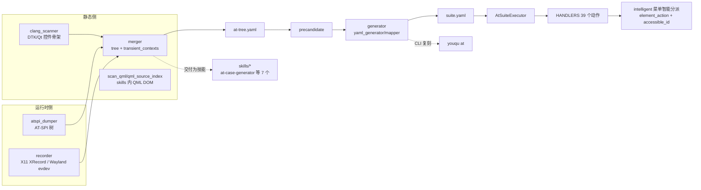

# youqu-ai 架构分析

- 会话 ID: `01a1e235-ae40`
- 项目目录: `/home/ut000635@uos/Documents/TestCode/youqu-ai`
- 创建时间: 2026-11-16T02:35:31.264Z
- 消息: user 2 / assistant 2
- 模型: deepseek-v4.1-flash-1017 × 61
- Token: input=125016, output=25955, cacheRead=2379136, total=2530107
- 工具调用 Top: bash×69, wait×2, write×1, edit×1
- 原始记录: `/home/ut000635@uos/.omp/agent/sessions/-Documents-TestCode-youqu-ai/2026-11-16T02-35-31-264Z_01a1e235-ae40-7000-9b6a-6841a6d39c79.jsonl`

## 用户提示词

### U1

分析当前项目

### U2

输出分析报告到当前目录

## 助手输出（按时间顺序，已省略 thinking 与工具参数）

### A1

分析完成，全程只读（只会生成临时环境 `/tmp/yqenv` 用于实测测试）。

## 结论

项目已从"桌面自动化测试框架"实质转型为"**AT-SPI 源码/运行时元树 → AI 语义映射 → 可执行 YAML 套件**"的管道工程：近 3 个月 84 次提交里 `src/at` 与 `skills/*` 占绝对主力，传统桌面模块停在维护态。工程质量前高后低——AT 管道有 954 个单测函数覆盖，但**测试基线在干净机器上是红的、无 CI 门禁、且 HEAD 提交了明文 API Key 与陈旧构建产物**。

## 规模事实

| 维度 | 数值 |
|---|---|
| 源码 `src/` | 40167 行 / 170 文件（其中 `depends/` 内嵌第三方 12574 行 / 41 文件） |
| `src/at` 管道 | 12098 行 / 37 文件（scanner 4728、executor 3946、generator 2486、validator 613） |
| `skills/` | 9616 行 / 19 py + 61 文件、7 个 skill |
| 单测 `tests/` | 17584 行 / 60 文件 / 954 个 test 函数 |
| CLI | 3161 行（`multica_agent.py` 1037、`at.py` 550、`main.py` 431） |
| 文档 | `docs/` 65 篇 md |
| 版本 | pyproject/CURRENT `2.19.8`，最新 git tag `v2.18.5`（发布流程缺打标） |

## 架构

关键设计点（已核实源码）：
- `execute_steps` 逐 step 分派 `HANDLERS`，`_run_handler_with_timeout` 用 `signal.alarm` 包超时，异常统一转字符串 → spec failed（错误语义正确，不会吞成功）。
- `_smart_wait` 会提前窥视下一步 selector 做条件等待，避免 `sleep` 竞态。
- 菜单项走 `intelligent.dispatch`（显示文本反查 + 键盘导航），绕开 DTK DMenu 弹出后 AT-SPI 不可见的限制。

## 实测基线（干净 uv 3.11 环境，无桌面/gi/libclang/qmldom）

`pytest -c pytest-tests.ini tests/`：**844 passed / 159 failed / 39 skipped / 6 errors**。失败可归因：

| 类别 | 数量 | 根因 | 性质 |
|---|---|---|---|
| `test_qml_*`（4 文件） | 59 | 缺 `/usr/lib/qt6/bin/qmldom`，断言前不 skip | 环境，但测试不自适应 |
| `test_skill_pms_*` | 5+6 | 缺 `bs4`，脚本硬退出 `SystemExit(1)` | 环境 |
| `test_vlm_config` | 2 | 仓库 `globalconfig.ini` 是 `localhost:8068 / Qwen3.8-27B`，测试硬编码 modelscope 默认值 | **真实红灯**，源于配置侵入测试 |
| `test_at_accessible_id` / `test_at_atspi_dumper` | 7 | 自建 `sys.modules["pyatspi"]=MagicMock()` + `tests/__init__.py` exec_module 的加载魔改，`monkeypatch.setattr(... "Registry")` 落空 | **真实红灯**（长期） |
| `test_web_spec_cli_main` | 2 | 子进程 `-m youqu.cli.main` 需已安装包，仓库布局下找不到 | 测试假设安装态 |
| 其他（parser/layout/clang/e2e） | 6 | 缺 libclang、需外部 PMS/VLM 服务 | 环境 |

无 CI 跑测试可解释红灯为何长期存在：`.github/workflows/` 只有 CLA、commitlint、GitHub→GitLab/Gitee 备份，**没有 lint/测试/构建流水线**。

## 风险清单（按严重度）

1. **明文凭证明文入库**：`setting/globalconfig.ini:328` `VLM_API_KEY = ms-6f1b1202-…`（ModelScope key），由提交 `2743926` 引入，仍在 HEAD。需：轮换密钥 → 配置改环境变量/本地覆盖文件 → `git filter-repo` 或至少承认历史泄露。
2. **构建产物入库且与源码脱节**：`dist/` 两个 wheel 被 git 跟踪（1.7MB）。`youqu_ai-2.19.8` 内 skills 仅 39/61 文件，**整缺 `at-case-from-pms` skill 与 `qml_source_index.py`，`scan_qml.py` 还是重构前旧版**。`publish.sh` 直接 `twine upload dist/*`，会把陈旧/多余 wheel 一并推上 PyPI。
3. **无 CI 门禁**：954 个测试靠人手跑；HEAD 存在 9 个与实现/配置漂移的红灯；`dist` 陈旧说明发布链路无「构建后校验」步骤。
4. **巨石模块**：`src/at/executor/handlers.py` 2395 行 / 39 handler / 135 处 `except Exception`（全仓 `src/at`+`cli`）。断言与动作、CDP、DBus、进程管理混在一个模块，新增 handler 需同步 `tests/test_at_executor.py` 的集合断言，耦合重。
5. **静默降级**：`src/__init__.py` 把 `AssertCommon/DogtailUtils/ImageUtils/OCR/ButtonCenter` 的导入失败替换为 `object`。headless 场景是有意设计，但对应用户工程是「继承 object 后运行时报错」的远距离故障，且吞掉真实 ImportError。
6. **双实现**：`youqu at` CLI（`cli/at.py`）与 `skills/*/scripts` 各自实现同一条管道，无共享代码；两者由不同测试覆盖（`test_skill_*` vs `test_at_*`），存在行为漂移面。
7. **超时保护仅主线程有效**：`_run_handler_with_timeout` 中 `signal.signal` 在非主线程抛 `ValueError` 被 `except: pass` 忽略，并行/子线程执行时 step 超时失效。
8. **文档漂移**：`AGENTS.md` 称 `globalconfig.ini` 有 12 个 section，实际 9 个（`run/remote/report/pmsctl/pmsctl-pms_link_csv/csvctl/log_cli/vlm/git`）。

## 建议优先级

1. 立即轮换 `VLM_API_KEY`，把 `setting/globalconfig.ini` 改为模板 + 本地覆盖；`dist/` 移出 git 并清理。
2. 加最小 CI：`ruff check` + `pytest tests/`（在带 `qmldom`、`libclang`、`bs4` 的容器里），并在 `publish.sh` 前加 wheel 内容校验（skills 文件数、`-m youqu.cli.main --help` 冒烟）。
3. 让环境相关测试用 `pytest.mark.skipif(shutil.which("qmldom"))` 显式跳过，而不是红；修 `test_vlm_config` 使其不依赖仓库内配置值。
4. `handlers.py` 按动作族（进程/键盘鼠标/元素/断言/WebEngine）拆包，保留 `HANDLERS` 单点注册表。

### A2

报告已写入 `PROJECT_ANALYSIS.md`（203 行）。

结构：

| 章节 | 内容 |
|---|---|
| 1 结论 | 转型判断 + 质量前高后低 |
| 2 规模事实 | `src`/`at`/`skills`/`tests`/`cli` 行数与文件数 |
| 3 架构 | mermaid 管道图 + 执行器语义（39 handler、超时、smart_wait、intelligent 菜单分派） |
| 4 开发重心 | 近 3 个月热点：`skills/*` 改动量约为 `src/at` 的 6 倍 |
| 5 实测测试基线 | 844 passed / 159 failed / 39 skipped / 6 errors，附失败归因表 |
| 6 风险清单 | 8 项，按严重度：明文 `VLM_API_KEY`（HEAD `setting/globalconfig.ini:328`）、`dist/` wheel 与源码脱节（skills 39/61 文件）、无 CI、`handlers.py` 2395 行、静默降级、双实现、alarm 仅主线程、文档漂移 |
| 7 建议 | 7 条优先级动作 |
| 附录 | 复现本次验证的 4 条命令 |

验证：`wc -l` 203 行，8 个一级章节齐全；mermaid 边标签已改为 `-. text .->` 合法写法；所有结论均来自本次实际命令输出（`git log`、`wc`、`pytest`、wheel 解包对比）。文件未提交，等你指示。
