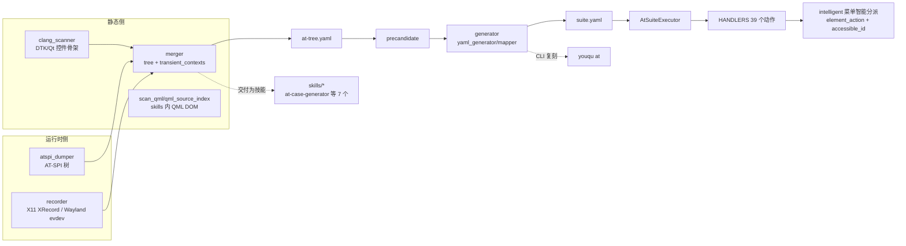

# 分析 youqu-ai 项目架构

- 会话 ID: `01a1e235-ae40`
- 类型: 顶层会话
- 项目目录: `/home/ut000635@uos/Documents/TestCode/youqu-ai`
- 创建时间: 2026-11-16T10:35:31+08:00
- 最后活动: 2026-11-16T17:37:31+08:00
- 消息: 用户提示词 2 / 助手文本 2 / 模型请求 61
- 模型: deepseek-v4.1-flash-1017 × 61
- Token: input=125,016, output=25,955, cacheRead=2,379,136, total=2,530,107
- 工具调用 Top: bash×69, wait×2, write×1, edit×1
- 原始记录: `/home/ut000635@uos/.omp/agent/sessions/-Documents-TestCode-youqu-ai/2026-11-16T02-35-31-264Z_01a1e235-ae40-7000-9b6a-6841a6d39c79.jsonl`

## 用户提示词

### U1

分析当前项目

### U2

输出分析报告到当前目录

## 助手输出（按时间顺序，已省略 thinking 与工具参数）

### A1

分析完成，全程只读（只会生成临时环境 `/tmp/yqenv` 用于实测测试）。

\## 结论

项目已从"桌面自动化测试框架"实质转型为"**AT-SPI 源码/运行时元树 → AI 语义映射 → 可执行 YAML 套件**"的管道工程：近 3 个月 84 次提交里 `src/at` 与 `skills/*` 占绝对主力，传统桌面模块停在维护态。工程质量前高后低——AT 管道有 954 个单测函数覆盖，但**测试基线在干净机器上是红的、无 CI 门禁、且 HEAD 提交了明文 API Key 与陈旧构建产物**。

\## 规模事实

| 维度 | 数值 |
|---|---|
| 源码 `src/` | 40167 行 / 170 文件（其中 `depends/` 内嵌第三方 12574 行 / 41 文件） |
| `src/at` 管道 | 12098 行 / 37 文件（scanner 4728、executor 3946、generator 2486、validator 613） |
| `skills/` | 9616 行 / 19 py + 61 文件、7 个 skill |
| 单测 `tests/` | 17584 行 / 60 文件 / 954 个 test 函数 |
| CLI | 3161 行（`multica_agent.py` 1037、`at.py` 550、`main.py` 431） |
| 文档 | `docs/` 65 篇 md |
| 版本 | pyproject/CURRENT `2.19.8`，最新 git tag `v2.18.5`（发布流程缺打标） |

\## 架构

关键设计点（已核实源码）：
- `execute_steps` 逐 step 分派 `HANDLERS`，`_run_handler_with_timeout` 用 `signal.alarm` 包超时，异常统一转字符串 → spec failed（错误语义正确，不会吞成功）。
- `_smart_wait` 会提前窥视下

…（截断，原文 4183 字符）

### A2

报告已写入 `PROJECT_ANALYSIS.md`（203 行）。

结构：

| 章节 | 内容 |
|---|---|
| 1 结论 | 转型判断 + 质量前高后低 |
| 2 规模事实 | `src`/`at`/`skills`/`tests`/`cli` 行数与文件数 |
| 3 架构 | mermaid 管道图 + 执行器语义（39 handler、超时、smart_wait、intelligent 菜单分派） |
| 4 开发重心 | 近 3 个月热点：`skills/*` 改动量约为 `src/at` 的 6 倍 |
| 5 实测测试基线 | 844 passed / 159 failed / 39 skipped / 6 errors，附失败归因表 |
| 6 风险清单 | 8 项，按严重度：明文 `VLM_API_KEY`（HEAD `setting/globalconfig.ini:328`）、`dist/` wheel 与源码脱节（skills 39/61 文件）、无 CI、`handlers.py` 2395 行、静默降级、双实现、alarm 仅主线程、文档漂移 |
| 7 建议 | 7 条优先级动作 |
| 附录 | 复现本次验证的 4 条命令 |

验证：`wc -l` 203 行，8 个一级章节齐全；mermaid 边标签已改为 `-. text .->` 合法写法；所有结论均来自本次实际命令输出（`git log`、`wc`、`pytest`、wheel 解包对比）。文件未提交，等你指示。

## omp 空闲摘要（recap，最新在前）

- 已按你的要求完成项目分析，报告已写入当前目录的 PROJECT_ANALYSIS.md，内容包含架构、实测测试基线和 8 项风险。下一步：等你确认是否需要修复最紧急的明文 VLM_API_KEY 密钥泄露，或者提交报告。

- 分析已交付：梳理了 youqu-ai 的 AT-SPI 管道架构、规模数据、实测测试基线（844 通过、159 失败）和八项风险清单。下一步可先轮换已泄露的 VLM API Key，并把 dist 产物移出 git。
