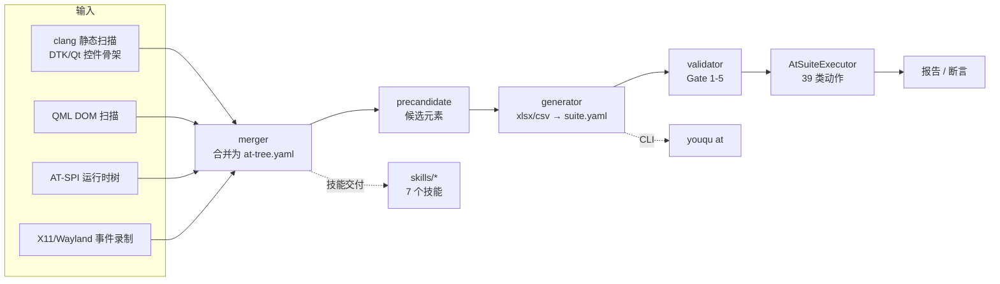
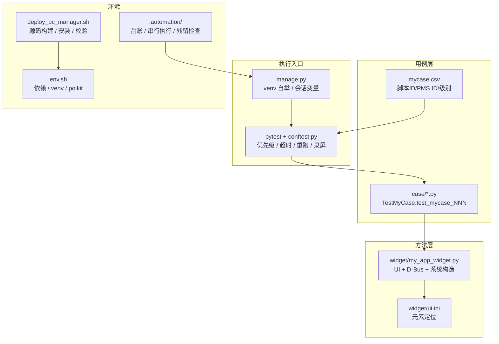

# 基于「有趣」测试框架用 AI 构建电脑管家自动化测试用例

> 项目方案总结与分享 ｜ 2026-11-16
> 数据来源：本机 25 个 omp 会话（2026-09-09 → 2026-11-16）、仓库 `youqu_deepin_pc_manager` 与 `youqu-ai` 当前代码/文档。会话明细见 `.omp-sessions/README.md`。
> 文中测试机地址、账号统一用 `<test-mac>` 代替，不记录密码。

---

## 0. 一页速览

| 维度 | 事实 |
|---|---|
| 被测产品 | 统信电脑管家 `deepin-pc-manager`（V20 阶段 1.1.7，当前 2.14.0） |
| 测试框架 | YouQu（有趣）v2.14.0，Python PO 模式；AI 框架侧用 `youqu-ai` 2.19.8 |
| 工程规模 | 348 个用例文件、`mycase.csv` 348 行登记、`apps/` 约 6.7 万行 Python（357 个文件 / 67,385 行）、`my_app_widget.py` 2.6 万行；仓库 1,216 次提交（`--all`） |
| 用例分级 | P1 81 / P2 131 / P3 115 / P4 20（另有 1 条未填） |
| 过检结果（V20） | 229 条待过检全部结案：213 通过、15 失败、1 废弃；15 条失败中 9 条产品缺陷、2 条功能下线、3 条判据与设计不符、1 条待复验，均有证据（2005479 按授权放宽后由失败转通过，失败数 16→15） |
| 全量结果（V25） | 361 个文件 / 362 条用例，8.5 小时串行：224 通过（62.0%）、95 失败（26.3%）、42 跳过（11.6%） |
| AI 投入 | 25 个会话、398 条用户指令、4,899 条助手消息、13,923 次模型请求、约 12.8 亿 tokens（含缓存读） |
| 主力模型 | `deepseek-v4.1-flash-1017`（8,821 次请求，约 63%）；`deepseek-flash` 4,541；`gpt-5.6-sol` 112；其余长尾 |
| 核心结论 | AI 不是"生成一堆用例"，而是被约束成 **逐条 worker**：领一条、读证据、改本地、远端实跑、失败归因、回退残留、记台账；人只保留验收口径与产品缺陷判定权 |

一句话方案：

> **把"用例过检"从人的手工劳动，改造成一条可审计的流水线：单一事实源（PMS/登记表）→ 单入口串行执行 → 真机行为取证 → 台账与证据链 → AI 按规程逐条闭环 → 文档沉淀给下一位接手者（人或 AI）。**

---

## 1. 使用了哪些 AI 模型参与

### 1.1 参与方式不是"一个模型写代码"

本项目对 AI 的使用分三层：

| 层次 | 用法 | 典型工作 |
|---|---|---|
| 交互式构建 | 人在 omp 里下达目标，AI 直接操作仓库与测试机 | 部署脚本改造、用例逐条过检、失败归因、报告生成 |
| 受约束 worker | 把作业规程写成 `PROCEDURE.md`，会话只处理 1 条用例 | 每 5 分钟唤醒一次，领 1 条，改完即停 |
| 框架内 AI 能力 | youqu-ai 自带 MCP Server / VLM / skills | AT-SPI 元素树获取、YAML 用例生成、PMS 缺陷单转用例 |

### 1.2 实际参与模型与分工

按会话中每条 assistant 消息记录的 `model` 字段聚合：

| 模型（provider） | 请求数 | 输入 | 输出 | 缓存读 | 承担的工作 |
|---|---:|---:|---:|---:|---|
| `deepseek-v4.1-flash-1017`（uniontech-ai） | 8,821 | 27.7M | 5.37M | 767.4M | **绝对主力**：部署、用例修改、远端执行、日志归因、报告 |
| `deepseek-flash`（deepseek） | 4,541 | 8.1M | 2.09M | 420.2M | 早期逐条执行、长会话中的默认模型 |
| `deepseek-v4-flash`（deepseek） | 342 | 0.41M | 0.19M | 29.6M | 2026-10 的部署/排障会话 |
| `gpt-5.6-sol`（justdowork-openai） | 112 | 9.0M | 0.01M | 0 | youqu-ai 架构分析、wheel 安装排障（大输入、短输出） |
| `deepseek-v4.1-flash`（uniontech-ai） | 105 | 0.28M | 0.09M | 6.5M | 早期部署与报告会话 |
| `claude-opus-5`（justdowork-claude） | 2 | 0 | 0 | 0 | 仅模型切换记录，未形成有效请求 |

观察：

1. **主力模型集中在"能长时间跑工具链"的 flash 级模型**，而不是最贵的推理模型。原因是任务绝大多数是"读日志 → 定位 → 改一个文件 → 跑一条用例"，吞吐与工具调用稳定性比单次推理深度更重要。
2. **大输入任务换模型**：youqu-ai 架构分析一次读 40k 行源码与 954 个测试，使用 `gpt-5.6-sol` 处理 9.0M 输入，输出只有 14.7k tokens，属于"重阅读、轻生成"。
3. **模型切换有成本**：同一会话跨模型会丢上下文风格，后期统一到 `deepseek-v4.1-flash-1017` 后，文档与台账格式才稳定。
4. **缓存读占 token 的 95.8%**（1.22B / 1.28B），说明长会话 + 大仓库上下文是主要成本来源；这也是后来强制"文档沉淀 + 单条任务"的原因。

### 1.3 AI 与人的分工

| 角色 | 职责 |
|---|---|
| 人 | 定验收口径（例如"点击后能进入结果页即通过"）、判定产品缺陷、决定版本变更用例是否下线、授权放宽判据、拒绝"改判据迎合实现" |
| AI | 读用例库与源码、构造数据、改用例/widget、远端执行、读 daemon 日志与 D-Bus、回退环境、写台账与文档 |
| 框架/脚本 | 串行锁、超时、结果解析、残留检查、报告裁剪；AI 不直接决定"通过" |

---

## 2. youqu-ai 项目介绍

### 2.1 定位

`youqu-ai` 是 YouQu（有趣）自动化测试框架的 AI 增强版（仓库版本 2.19.8，GPL-2.0）。传统 YouQu 提供 Linux 桌面 UI 自动化能力（AT-SPI、图像识别、OCR、键鼠、D-Bus、Web、HTTP），youqu-ai 在此之上增加了：

- **AT-SPI 源码/运行时元树 → AI 语义映射 → 可执行 YAML 套件** 的管道；
- **MCP Server**，把桌面操作暴露成 AI 客户端可调用的工具；
- **VLM 视觉**（可选，OpenAI 兼容后端）；
- **7 个 AI 技能**（SKILL.md + 脚本），覆盖用例编写、PMS 缺陷单转用例、AT-SPI 覆盖扫描等；
- **YAML 与 Python 双路径**：`youqu at` 执行声明式 YAML，`manage.py` 执行传统 PO 模式。

### 2.2 架构

关键设计（来自 `PROJECT_ANALYSIS.md`，2026-11-16 实测）：

| 模块 | 规模 | 说明 |
|---|---|---|
| `src/` | 40,167 行 / 170 文件 | 含内嵌第三方 `src/depends/` 12,574 行 |
| `src/at` 管道 | 12,098 行 / 37 文件 | scanner 4,728、executor 3,946、generator 2,486 |
| `skills/` | 9,616 行 / 61 文件 / 7 个技能 | `at-case-generator`、`at-case-from-pms`、`at-spi-coverage`、`at-case-authoring` 等 |
| `tests/` | 17,584 行 / 954 个测试函数 | 干净环境实测 844 passed / 159 failed / 39 skipped / 6 errors |

值得借鉴的两个工程点：

1. **执行器不吞失败**：step 超时与异常统一转成 failed，不会把异常当通过；`intelligent.py` 专门解决"DTK 菜单弹出后菜单项对 AT-SPI 不可见"，按 popup id 分类后用键盘导航。
2. **技能即产品**：近 3 个月 `skills/` 的文件改动量是 `src/at` 的 6 倍以上，说明交付物重心从 Python API 转向"给 AI Agent 的 SKILL.md + 可执行脚本"。

同时也要看到风险（同一份分析报告）：

- `setting/globalconfig.ini` 提交了明文 `VLM_API_KEY`，仍在 HEAD；
- `dist/` 的 wheel 与源码脱节（2.19.8 的 wheel 缺 `at-case-from-pms` 等文件），`publish.sh` 不清理 `dist/`；
- 无 CI 跑测试/构建，954 个测试长期人工触发；
- `handlers.py` 2,395 行、39 个 handler 集中在一个模块；`cli/at.py` 与 `skills/` 是两套并行实现，语义修正要改两处。

### 2.3 对本项目的实际作用

| 能力 | 在本项目中的使用 |
|---|---|
| AT-SPI 元素树/`dogtail` | Python PO 用例的底层定位基础 |
| `youqu doctor` / `env.sh` | 测试机依赖安装、AT-SPI 开启、环境自检 |
| `youqu at`（YAML 管道） | 未在本项目主链路使用，作为后续迁移方向 |
| MCP Server | 未接入日常过检；适合"AI 直接点桌面"的探索式场景 |
| `at-case-from-pms` | 方法论参考：缺陷单四要素 → 可转换性判定 → 规范用例 → 校验 → suite 增量 |
| Allure / `conftest.py` | 报告与优先级映射（本项目补了 P1–P4 → severity） |

结论：youqu-ai 提供的是"能力底座 + AI 交付形态"，本项目提供的是"一个真实产品上的完整落地样本"。两者互补，但当前项目的过检链路仍以 Python PO + 真机执行为主，AI 主要负责"改与验"，不是"生成后直接信"。

---

## 3. youqu_deepin_pc_manager 项目介绍

### 3.1 目标与范围

用 YouQu 对电脑管家做桌面 UI 自动化，覆盖：

- 系统检测（系统环境/更新环境/硬件/网络四大分项）；
- 系统优化（空间清理、垃圾清理、大文件/重复文件、启动项）；
- 修复工具（系统修复、桌面修复、第三方应用修复、外设/USB、打印机、音频）；
- 实用工具、性能（valgrind）、埋点、启动器/任务栏等系统集成场景。

用例来源是 PMS 用例库与《V20 电脑管家自动化测试单用例过检登记表》，**登记表是编号与优先级的唯一事实源**。

### 3.2 规模

| 指标 | 数值 |
|---|---|
| 用例文件 | 348 个 |
| `mycase.csv` 登记 | 348 行 |
| 用例级别 | P1 81 / P2 131 / P3 115 / P4 20 / 未填 1 |
| `apps/` Python | 67,385 行 / 357 个文件（`find apps -name '*.py'`） |
| `my_app_widget.py` | 26,161 行（页面方法层，PO） |
| 仓库提交 | 1,216 次（`git rev-list --count --all`，含 472 个分支引用） |

### 3.3 结构

### 3.4 部署链路（本项目最值得复用的部分之一）

`deploy_pc_manager.sh` 做的不只是"装包"，而是把测试环境的全部前提编码：

1. 按系统能力探测写 apt 源（V20=eagle / V25=snipe），备份后**保持生效**，隔离不匹配的 `sources.list.d`，避免构建期把 `libc6/systemd/sshd` 连带升级；
2. 自动识别 V20（Qt5/DTK5）或 V25（Qt6/DTK6），处理 dev 包版本约束、DTK soname、`lrelease` 路径；
3. 从 Gerrit 拉源码构建（默认 `develop/refactor` 最新提交），**构建失败直接报错，不静默回退仓库旧版**；安装后校验版本与源码一致；
4. polkit 预授权（两套后端：pkla / rules_js），修策略文件权限，让 UI 自动化能跨过系统认证弹窗；
5. 安装用例依赖（`iputils-arping` 等）；
6. `.venv` 只装框架依赖，**不写系统 site-packages**；把 `.venv/bin` 前置到 PATH，`manage.py` 发现解释器不在 venv 时自动 `execv`；
7. V25 额外处理 PEP 668、`packaging` 无法卸载、`setuptools≥81` 移除 `pkg_resources`、`/usr` 只读 overlay。

### 3.5 用例组织与判定

- **一条用例一个文件**：`test_mycase_<脚本ID>_<PMS用例ID>_<描述>.py`；方法名、csv 编号、文件名前缀三者必须一致，否则 `-k` 跑错对象。
- **PO 模式**：页面方法集中在 `my_app_widget.py`，用例只做"构造 → 操作 → 断言 → 回退"。
- **判定口径**（用户确认）：精确数值不要求逐字匹配，但必须有等价断言；核心是按描述构造数据并走完整流程；每条必须闭环、测试机零残留。
- **禁止**：`pytest.skip` 逃避、`pass` 占位、只 `sleep` 不断言、`assert True`。
- **分级进入报告**：`conftest.py` 把 csv 的 P1–P4 映射为 Allure `BLOCKER/CRITICAL/NORMAL/MINOR`，修复了"优先级恒 normal"。

### 3.6 自动化过检骨架（`.automation/`）

| 文件 | 作用 |
|---|---|
| `manifest.json` | 229 条待过检清单，内嵌用例库前置/步骤/预期 |
| `harness.py`（361 行） | `next / case / beat / record / release / status / export / requeue-failed`；文件锁 + owner 心跳保证串行 |
| `PROCEDURE.md` | worker 作业规程：身份、铁律、判定标准、失败上限、收尾、禁止提问 |
| `MONITOR.md` | 心跳超时 → 核查 → 回收 → 接手 |
| `scripts/run_case.sh` | 同步 → 远端加锁执行 → 结果判定 → 残留检查 → 报告裁剪 |
| `scripts/remote_run.sh` | 测试机侧 `flock` + 默认 1500s（可覆盖）超时 + 前后清理应用进程 |
| `scripts/remote_check.sh` / `remote_clean.sh` / `remote_prune.sh` | 残留检查 / 清理 autotest 对象 / 报告裁剪 |
| `ledger.json` / `history.jsonl` | 逐条状态台账 / 全量事件流水 |

### 3.7 结果

| 阶段 | 结果 |
|---|---|
| V20 单用例过检（229 条） | 11-12 定稿：213 通过 / 15 失败 / 1 废弃（2005479 按授权放宽通过条件后 `1 passed in 57.01s`，失败数 16→15）；15 条失败：9 产品缺陷、2 功能下线、3 判据与设计不符、1 待复验，全部有源码行号/日志/截图证据；未改产品源码、未为迎合实现改判据 |
| V20 后续（11-13） | 232/233/057 删埋点断言，改为"进入运行时页 + 扫描/结果页/启动项列表加载"并真机 PASS；082 改判"免鉴权直修成功"（ADR-0014，daemon 日志留证）；047 valgrind 单轮 318→74s；152 收尾 230s 内通过 |
| V25 全量（362 条） | 8.5 小时串行：224 通过 / 95 失败 / 42 跳过；失败主题：清理 31、其他 23、第三方应用修复 10、系统检测/更新 8、音频 8、打印机/权限 6、外设 USB 5、网络/仓库 4 |
| V25 修复 | 在独立工作树 `fix/v25-single-case` 按最小改动继续；17 条"旧通过→新失败"用 5 组对照（稳定性/会话变量/启动方式/AT-SPI 残留/daemon 状态）排除了代码原因，定位为测试机重置后的干净基线差异 |

---

## 4. 构建和优化过程中踩了哪些坑，怎么解决的

以下每条都来自会话中的实测记录；只写有日志、源码行号或复跑结果支撑的结论。

### 4.1 部署与环境

| # | 现象 | 根因 | 解决 |
|---|---|---|---|
| 1 | `deploy_pc_manager.sh` 报 `g++` 依赖冲突，最终装成仓库 1.0.10，用例覆盖不到新功能 | V20 的 Qt5/DTK5 运行时是 `+sign` 版本，仓库 `qtbase5-dev` 要求精确同版本 | `g++` 元包按 eagle 8.3 降级（只降元包）；Qt5/DTK5/GL 开发包解包到 `/usr`，不注册 dpkg 依赖；按 `debian/control.1` 打 V20 包；构建后校验版本；**失败不静默回退** |
| 2 | 测试机 apt 装包后 `libc6/systemd/sshd` 被升级，SSH 失联/无法登录 | 机器上混入 V25 源，构建期 `apt install` 连带升级 | 装包前按系统版本写源；隔离 `sources.list.d` 中不匹配的源；备份到 `/var/backups/youqu-apt-sources/`；部署期间保持源生效不还原（用户决策） |
| 3 | V25 `pip` 报 `externally-managed-environment`；`pipenv` 装不上（`Cannot uninstall packaging 25.0`）；`pytest-rerunfailures` 导入崩 | PEP 668；Debian 包无 RECORD；`setuptools≥81` 移除 `pkg_resources` | 能力探测而非版本号分支：pip≥23 加 `--break-system-packages`，统一加 `--ignore-installed`，固定 `setuptools<81`，剔除 apt 已提供的同名分发包；`/usr` 只读时 `mount -o remount,rw usr-overlay /usr` |
| 4 | V25 检测项 D-Bus 报 `AccessDenied: Authorization denied` | V25 无 `/etc/polkit-1/localauthority/50-local.d`，`env.sh` 的 pkla 预授权被静默跳过 | 双后端：目录探测 pkla / rules_js；写 `/etc/polkit-1/rules.d/49-pcmanager-test.rules`；`pkcheck` 自检；预授权放在产品安装后（action 安装后才注册）；`pkcheck -u` 不是"指定用户" |
| 5 | SSH 启动的电脑管家左侧栏毛玻璃消失、主题/图标漂移 | 裸 SSH 环境缺 `XDG_CURRENT_DESKTOP=DDE`、`QT_QPA_PLATFORM=dxcb;xcb`，DTK 不向 kwin 申请模糊区域 | `manage.py` 用 `setdefault` 补会话变量；按 `DISPLAY_SERVER` 决定 x11/wayland 是否强制 `QT_QPA_PLATFORM`；`xprop` 验证 `_KDE_NET_WM_BLUR_BEHIND_REGION=1` |
| 6 | 电脑管家报"关键库依赖问题" `failure:3012`，被误判为用例没回退干净 | 测试项目把 numpy/Pillow/cryptography 等 39 个同名 `.so` 写进了系统 site-packages，与 apt 包冲突 | 框架依赖只装 `.venv`；`.venv/bin` 前置 PATH；`manage.py` 自动 `execv` 到 venv；部署脚本同步依赖时剔除 apt 同名包 |
| 7 | 测试机无 `sshpass`、V25 无外网，apt/pip 全部失败 | 环境限制 | 宿主机起正向代理并写 `apt.conf.d`；用 paramiko/rsync/包装脚本替代 sshpass；部署脚本把代理作为可覆盖项 |
| 8 | Allure 套件列表中文乱码 | `conftest.py` 对 nodeid 做了双重 `unicode_escape` | 删掉两行转换；项目仓与 youqu-ai 框架仓同步修；重新构建 wheel（`dist/` 里会残留旧 wheel，2.19.7/2.19.8 并存） |
| 9 | 报告里单条用例优先级恒为 `normal` | 只用了 Allure 的 `L1–L4` 枚举，csv 里是 P1–P4 | `conftest.py` 增加 P1–P4 映射；重跑后 P1/P2 显示 blocker/critical |

**经验**：不要按 OS 大版本写 if/else，按**能力探测**（pip 版本、polkit 目录、`/usr` 是否 overlay、`DISPLAY_SERVER`）。版本号只用于报告标注与错误提示，不参与安装逻辑。V20/V25 分支越多，没机器验证的那一支腐烂得越快。

### 4.2 产品行为与 AT-SPI 能力边界

| # | 现象 | 根因 | 解决 |
|---|---|---|---|
| 1 | 用例 PASS，但用户观察到"根本没执行检测" | QML/AT-SPI 的 `showing` 恒为 `False`；`wait_for_scan_progress` 用它判断且丢弃返回值 | 可见性一律用 `size != (0,0)`；新增 `wait_for_scan_started()`，点击后必须断言运行态/结果态出现；封装 `_any_visible()` |
| 2 | 单项检测结论读不到 | V20 QML 的 Label/ListView 不向 AT-SPI 暴露文本与单项状态，只有分项问题总数 | 走产品自身 D-Bus：`org.deepin.PCManager1.Detect(id)` → Task → `Task.GetResult`；会话总线不认识时回退系统总线；两条都不实现才退回分项级断言 |
| 3 | 用例停了很久，daemon 日志里却没有 `execute: received request` | AT-SPI `Press` 被产品忽略（不是弹窗阻塞、不是鉴权失败） | `click_start_repair_button_until_dialog(3×20s)` 有界重试；点击后必须看到目标对话框/输出，否则重试而不是无限等 |
| 4 | 断言早过了，用例 400–500s 才结束，甚至被外层 timeout 杀掉 | 修复完成弹窗 `timeoutMs=0`，永不自动消失，`exec()` 一直阻塞 | `wait_and_clear_repair_result()`：每轮看到弹窗就点，不依赖正文；命中关键字或修复窗口不可见即返回；`finish_repair_flow()` 统一收尾并在 `kill_pc_manager()` 兜底 |
| 5 | 弹窗断言写成"等正文出现再关" | DTK 标签的 AT-SPI `name` 是 objectName，正文读不到 | 断言"弹框存在 + 标题 + 按钮文案"；正文从 session 总线 `OpenMessage` 请求参数取；窗口关闭用 X11 标题判定（AT-SPI 节点销毁后仍报 `showing=True`） |
| 6 | `find_element` 找不到控件，但不知道是元素名写错还是回退命中 | 控件查找有多级回退，旧日志只打印成功 | 统一日志：区分"候选回退 / 真实未命中"，未命中打印匿名控件文本，一行可 grep；批量跑 63 条用例（41 通过 / 22 失败，14 个直接未命中）验证日志足以定位问题 |
| 7 | 大文件/重复文件清理、启动管理器点击用例长期红 | 产品埋点 `optimization_page.cpp:477/479/481` 用 `pluginName` 比 `large-file-clean`/`startup-management`，实际 `plugin.name` 是 `large-file`/`startup`，pageId 全落 `space_clean` | 产品缺陷单留档；按用户口径把通过条件收敛为"能进入运行时页并走到扫描/结果页/启动项列表加载"；埋点缺陷写进 docstring，不丢证据 |
| 8 | "一键修复需要鉴权"用例 120s 内无鉴权框，长期失败 | 产品对受信调用方 `Fix(id)` 免密（`detection_page.cpp:767` + ADR-0014） | 改判：10s 内无 polkit 对话框 + daemon 日志 `blockingCall "Fix" ... terminal: success = true code = 0` + `finishFullScanFixAll: fixed 1 failed 0`；`dde-polkit-agent` 常驻，不能靠进程存在性判断 |
| 9 | CPU 温度/磁盘健康/jq 用例整组失败 | 测试机缺 `lm-sensors`/`smartctl`/`jq`；UOS dpkg 白名单拒绝安装非白名单包 | `ensure_package_installed(pkg, probe)`：已装复用，缺失则 apt 安装，失败先 `apt-get update` 重试；安装前用 `apt-get install -s` 解析依赖闭包，临时写入 `package_white_table`，`finally` 删除，白名单条数回 2029 |
| 10 | 237"要求 sensors 缺失"被 288 装上的 lm-sensors 打断 | 288 的依赖预检永久装包，237 把"缺失"写成死前置 | "要求缺失"的用例自己 `mv` 构造缺失态并回退（不卸载包、不改 dpkg 状态）；"要求存在"的用预检补齐；同一台机器两个方向各自自洽 |
| 11 | 190"多分区显示"突然失败，断言 `len(rows)==3` | 测试机多了 udisks 自动挂载的真实内部数据分区（`/dev/sda6`），产品列表把真实分区也列出 | 改为"注入行必须出现且顺序正确 + 其余行必须是真实 `/media/*` 挂载点"；不再写死行数；可移动盘被产品剔除，不能用挂载数反推 |
| 12 | 168 输入法"已激活"但按键直通、候选条永不出现 | fcitx 与 cpis 配套服务跨代配对，状态位仍报激活 | `restart_input_method_stack()` 清配套服务后整栈重启；重开编辑器并重试一次；恢复耗时不计入卡顿阈值；注入破坏验证恢复分支 |
| 13 | 047 valgrind 用例 4–8 分钟且长期失败 | valgrind 在自身进程内运行被测程序，不 fork；`grep -c` 输出 `1`/`0` 被当子串判断；关窗常只回托盘；`pgrep -f` 先命中中间 shell | 只认 `valgrind.bin`；关窗 10s 不退发 SIGTERM，等泄漏汇总；判定按记录首帧归属（跳过 `vg_replace_malloc` 包装帧），不按栈里是否出现产品帧；单轮 74–79s |
| 14 | 进程相关判断偶发失效 | `pgrep -x` 与 15 字符 `comm` 截断：`gnome-keyring-daemon` → `gnome-keyring-d`，`deepin-pc-manager` → `deepin-pc-manag` | 所有进程匹配改用截断名；排除列表同步补全 |
| 15 | `arping -D` 在无冲突时也返回 1 | 同一 netns 内的 veth 对会把自己的广播回环回来 | 对端放进独立 netns；`veth` 用与办公网无关的 `192.168.77.0/24`，避免影响 SSH |
| 16 | 内存检测偶发"未判异常" | 两个 067 实例相隔 8s 并发，共用 `/mnt/pcm067-mem`，一个实例 umount 掉另一个的 tmpfs | 用例加跨进程 `flock`（`/tmp/pcm_conflict_test_067.lock`），拿不到锁直接 `SKIPPED`；内存构造余量 14%→10% |
| 17 | 磁盘 96% / `/boot` 93%，环境越跑越脏 | `disk_space`/`boot_partition_space` 构造的 fill 文件在实例被中断后没进 `finally` | 杀残留实例 + `rm -f` fill 文件；`find / -xdev -size +500M` 查散文件；报告/`/tmp/_allure_*` 定期裁剪 |

**经验**：**PASS 不是行为发生的证据**。UI 自动化必须用"产品自己的日志 / D-Bus 返回 / 系统状态变化"取证；AT-SPI 只是操作通道，不是事实来源。

### 4.3 用例判定与环境隔离

| # | 坑 | 解决 |
|---|---|---|
| 1 | 判定只看"按钮点了"，不看行为 | 每个"点击后应发生某行为"的步骤都补行为断言；点击全面检测→检测运行态/结果态；点击修复→daemon 收到请求 + 修复窗口出现 |
| 2 | 用例实际跑的是"全面检测"，却以为在测分项 | 点击目标分项卡片后，用 `is_only_group_detected(<卡片名>)` 断言"该分项跑完且其它 4 张卡片的已检查数为 0" |
| 3 | 清理类用例误删测试机真实数据 | 重复文件/大文件用例前置把真实文件临时移出扫描范围（≥1MB / ≥100MB），`finally` 按原路径恢复；重复文件用"尺寸 + 首尾 64KB 采样 MD5 成组"判定；候选 >200 直接报错要求清理，不静默部分隔离 |
| 4 | 301"智能选择→彻底删除"把结果列表所有组都删了 | 改为只删除选中的文件；断言"删后剩余恰好 2 个"；环境隔离覆盖项目目录 |
| 5 | 密钥环备份把上一次有效备份覆盖，造成真实文件永久丢失 | 任何 `backup_*` 都不许无条件覆盖：发现遗留非空备份先 `restore_*` 再重新备份；这条是在真实事故后写进规程的 |
| 6 | 043 因 sda6 被 201 覆盖成 5GiB 而失败 | 重建 sda6；201 改为 Skip；同族用例排查环境互踩 |
| 7 | 构造系统级异常失败，排查靠猜 | 构造三原则：幂等（先清历史残留）、防御（写前 `chattr -i`）、顺序正确（`chattr -i` → 改文件 → 恢复）；构造失败时异常带 `grep` 计数、`tail`、`lsattr` |
| 8 | `sources.list` 残留 immutable，`sed` 静默失败 | 构造与清理都先 `chattr -i`；写后 `lsattr` 校验并重试；产品侧同时报 `failure:3011` |
| 9 | `coredump` 前置偶发未落盘 | 写入后 `cat` 校验并重试 3 次；备份值含 `pcm067` 时回落 `systemd-coredump` 默认值 |
| 10 | 用例编号撞号、跑错对象 | 登记表是唯一事实源；改完必须全过：csv 编号/ID 唯一、每个方法在 csv 有登记、`NNN` 等于文件名前缀、`--collect-only` 每个方法只出现一次且挂在正确文件 |
| 11 | `test_mycase_065` 被重复收集、`2005451` 一个文件两条用例 | 修收集逻辑；知道"一个文件多条用例"是登记表允许的，跑全量时单独拆开验证 |
| 12 | 用例里 `from src import log` 后 `log("...")` 静默 no-op | `funnylog.log` 是类装饰器，不是日志函数；统一改 `logger.info()`；用 `grep -rn "from src import log$"` 排查 24 个文件，不无脑 sed（装饰器用法会被破坏） |
| 13 | 跳过原因在日志里只有一个 `SKIPPED` | `conftest.py` 加 `pytest_runtest_logreport`，`report.skipped` 时打印 `longrepr`；42 条跳过的原因第一次变得可读 |
| 14 | 100MB 大文件正好卡在产品"大于 100MB"阈值 | 测试数据提到 120MB；阈值类用例显式写出边界，并用 100/101/120MB 验证 |
| 15 | 报告里 PASS 但运行被 kill | 被 kill 时 `parse_result.py` 会读到上一次的旧 json 误报 passed | 结论以 `RUN_RC`/`SSH_RC` 为准；json 文件名时间戳必须晚于本次启动时间 |

**经验**：判定口径要"等价但可证"：允许页面/元素/进程/返回码/文件变化等等价断言，但禁止常量断言、空跑、只等不断言。破坏性用例先隔离真实数据，备份永不覆盖，收尾必须自查。

### 4.4 执行编排与报告

| # | 坑 | 解决 |
|---|---|---|
| 1 | 同一台机器并发跑多个 `manage.py`，应用实例互相干扰 | 单入口（只用 `manage.py run`，不手敲 pytest）；远端 `flock /tmp/pcm_case.lock`；本地 owner 心跳；拿不到锁 `BUSY`/`SKIPPED`，不重试 |
| 2 | 网络类用例会切断 SSH，导致整批中断 | 网络设置/IP 冲突类放到最后；用独立 netns/veth 构造；管理网卡方案失败过（双接口同网段冲突导致失联），最终以隔离网段 + 串行为主 |
| 3 | 全量跑到一半测试机失联，远端进度与结果拿不到 | 心跳按 `lastBeatEpoch` 判超时（`--stale`，默认 3600s）；远端无进程才 `release` 回收，再由 `requeue-failed` 重跑；恢复后以远端结果文件为准，不把"没结果"当通过或失败 |
| 4 | 报告/录屏持续累积，`/tmp/_allure_*` 涨到 1.8G（83 个 22M 目录） | `remote_prune.sh` 保留最近 30 份日志/结果、删 2 天前录屏与 allure 备份；`/tmp/_allure_*` 定期清；磁盘低于阈值时监控介入 |
| 5 | 单条用例耗时差异巨大：检测类 100–350s，音频修复 5–13 分钟，失败重跑翻倍 | 用例级超时 1800s；失败上限 3 次（初次 + 2 次重试）；单条独立进程 + 独立日志；不做"边改边全量跑" |
| 6 | 全量结果没有按主题聚合，95 条失败无法排优先级 | 从日志提取断言行生成 `fail_points.tsv`，按清理/检测/修复/外设等主题分类；先修"工程问题"，再提产品缺陷 |
| 7 | 远端与本地代码漂移 | 先改本地，再 rsync/base64 上传；中文文件名用 base64 最稳；远端不做直接编辑；跑前校验两端一致 |
| 8 | 用例执行被当成"应用启动次数" | 应用启动会自动触发检测任务，启动几次 ≠ 跑了几条用例；判断是否重跑看 allure result 条数与 `execution_count`，看 `handleFullScanCompleted` 时间线 |

**经验**：长跑测试的第一公民是**串行与可恢复**，不是速度。台账 + 心跳 + 残留检查 + 报告裁剪，四件套缺一不可。

### 4.5 AI 协作本身的坑

| # | 坑 | 表现 | 解决 |
|---|---|---|---|
| 1 | AI 把"点了按钮"当"行为发生" | 用例 PASS 但实际没执行检测 | 把"证据优先"写进规程；要求 AI 用 daemon 日志/D-Bus/系统状态确认，不接受 UI 假象 |
| 2 | AI 无限等弹窗/等文案 | 用例 400–500s 不退出 | 所有等待必须有界；"看到就点 + 提前退出"；禁止用 `continue` 表达"再等等" |
| 3 | AI 为了变绿改判据 | 想把产品缺陷改成通过 | 人保留验收权；产品缺陷记 `fail` + 根因 + 源码行号；只有用户明确授权才放宽（2005479、232/233/057、082/083 均属授权改判，且在文档留痕） |
| 4 | AI 忘记回退，环境越跑越脏 | 密钥环丢失、sda6 被覆盖、磁盘 96% | 规程强制 `finally`；备份不覆盖；残留检查脚本；每轮结束自查清单 |
| 5 | AI 记不住上一次的结论 | 同类坑反复踩 | `PC_MANAGER_TESTING_NOTES.md` 675 行"只写实测、标注未验证"；recap 自动摘要；文档成为下一位 AI 的上下文 |
| 6 | AI 在错误环境上执行 | 测试机因网卡配置/管理网卡冲突失联（`.97` 不可达）、用例名拼错（`test_maycase_058`）导致 0 条选中 | 执行前先连通性与用例收集校验；命令回显；失败先怀疑"选中的是 0 条" |
| 7 | AI 自己被"卡住" | 用户多次问"卡住了吗？/你在干嘛？" | 长任务拆检查点定时汇报；后台 job + 增量日志；单条处理完即停，不顺手做第二条 |
| 8 | 同一文件被多会话并发修改 | 两条会话同时改同一用例 | 本地 owner 锁 + 远端 flock；心跳 3600s 才算 stale；无 owner 且台账 90 分钟未更新才判悬挂 |
| 9 | 上下文爆掉后结论丢失 | 长会话 137 条指令后需要重新解释 | 关键结论即时写进笔记/台账，不依赖会话记忆；按"一条用例一次唤醒"控制上下文 |
| 10 | 模型误读产品源码 | 把"产品启动时自动检测"当成"用例触发" | 读源码 + 日志 + 实测三方交叉；结论写清证据位置（文件:行号） |

### 4.6 十条可复用的解决经验

1. **能力探测优于版本判断**：pip/polkit/overlay/显示协议都探测，别写 V20/V25 两套。
2. **构建失败不静默回退**：静默回退会制造"测试通过但测的是旧版本"的假象。
3. **PASS 不是证据**：以产品日志、D-Bus、系统状态为准；UI 只能证明"点到了"。
4. **有界重试 + 提前退出**：所有等待都要有超时、退出条件和现场信息。
5. **构造-执行-断言-回退四段闭环**：`finally` 是硬约束；备份永不覆盖。
6. **负面状态自己构造**：要求"缺失/异常"的用例自己造并回退，不依赖机器现状。
7. **单一事实源**：用例编号、优先级、期望以 PMS/登记表为准，代码与 csv 双向校验。
8. **单入口串行**：一把锁、一个入口、一条用例；并发是脏环境和误判的源头。
9. **证据链即交付物**：台账、日志、源码行号、复跑次数，缺一不可；否则无法区分"用例错"和"产品错"。
10. **文档是 AI 的接口**：写给下一位接手者（人或 AI）的实测笔记，比任何 prompt 都值钱。

---

## 5. 相比其他桌面项目，有哪些可以借鉴的地方

这里的"其他桌面项目"指其他基于 YouQu/同类框架的桌面应用自动化工程。本机没有其他项目的完整用例库可直接对照，因此下面按"可移植实践"归纳，而不是逐项 feature 对比。以下 17 条按"直接可复制 → 需要产品配合 → 组织流程"排序。

### 5.1 直接可复制

| # | 做法 | 为什么值得借鉴 | 落地方式 |
|---|---|---|---|
| 1 | **一键部署脚本把测试环境前提全部编码** | 桌面自动化的失败大多不是用例错，而是环境差（源、Qt 版本、polkit、会话变量、venv） | 把 `deploy_*.sh` 作为项目一等公民；能力探测 + 自检 + 失败即报错；部署后打印被测版本 |
| 2 | **`.venv` 与系统 site-packages 严格隔离** | 测试框架依赖与产品"关键库检测"会互相踩；同名 `.so` 会造成产品假故障 | 框架依赖只进 venv；PATH 前置；入口解释器自举；部署时剔除 apt 同名包 |
| 3 | **AT-SPI 不够时用产品 D-Bus 取证** | QML/V20 的 UI 树经常不暴露状态；只靠 UI 断言会长期红或假绿 | 封装 `get_*_verdict()`：会话总线 + 系统总线回退；返回 `None` 时区分"未实现/鉴权失败/总线不认识" |
| 4 | **等价断言 + 行为证据** | 用例库的精确数值（扣分、项数、耗时）不可稳定复现 | 允许页面/进程/返回码/文件变化等价；每个操作后断言行为；禁止空断言 |
| 5 | **清理/破坏性用例做环境隔离** | 测试机上的真实数据会被误删；真实大文件会让结果断言失真 | 前置移出真实文件、`finally` 恢复；备份不覆盖；候选超限直接报错 |
| 6 | **残留检查与报告裁剪脚本化** | 长跑必然留残留；磁盘满会中断整批 | `remote_check/clean/prune` 三件套；每条后检查；日志/结果保留最近 30 份、录屏删 2 天前 |
| 7 | **单入口 + flock + 超时 + 失败上限** | 并发和无限重跑是误判的主要来源 | `run_case.sh` 固定流程；远端 `flock`；3 次失败即记 fail 并继续 |
| 8 | **台账/心跳/证据链** | 没有台账就无法回答"这条到底跑没跑、跑了几次、为什么失败" | `.automation/harness.py` 模式：`next/beat/record/release/status/export`；JSON 台账 + JSONL 流水 |
| 9 | **优先级映射进报告** | 报告是交付物；全 `normal` 无法排优先级 | csv P1–P4 → Allure severity；跳过原因打印 `longrepr` |
| 10 | **依赖预检而不是 skip** | "缺工具就跳过"会掩盖产品能力与用例覆盖 | `ensure_package_installed`；UOS 白名单临时放行；"要求缺失"的用例自己构造缺失态 |

### 5.2 需要产品/需求配合

| # | 做法 | 价值 | 前提 |
|---|---|---|---|
| 11 | **判定口径与产品设计对齐** | 082/083 的"必须鉴权"与产品 ADR-0014"受信调用方免密"冲突，错在用例预期 | 需求方确认语义；产品提供检测项 D-Bus、错误码表、埋点字段说明 |
| 12 | **失败分类：产品缺陷 / 版本变更 / 判据冲突 / 环境限制** | 15 条失败里 9 条产品缺陷、2 条功能下线、3 条判据不符、1 条待复验；混在一起会误导 | 每条失败必须给根因与证据；产品缺陷不改产品源码、不提"假缺陷"；版本下线由需求方决策 |

### 5.3 组织流程

| # | 做法 | 价值 |
|---|---|---|
| 13 | **AI 作为"逐条 worker"，不是"一把梭生成器"** | 398 条指令、1.39 万次请求换来的不是 348 条新用例，而是 229 条真实过检 + 95 条按主题归因的失败；可控、可审计 |
| 14 | **给 AI 写作业规程（PROCEDURE/MONITOR）** | 身份、铁律、允许改的文件、判定标准、失败上限、收尾、禁止提问；换模型/换会话仍能接力 |
| 15 | **文档即交接**：`PC_MANAGER_TESTING_NOTES.md` | 675 行只写实测与 `[未验证]`；下一位 AI 不必重新踩坑；也是本次分享的事实底稿 |
| 16 | **测试机先跑"安全集"再跑"高风险集"** | V25 全量 361 个文件：安全 85 条先跑，高风险 276 条（含网络/IP 冲突）后跑，避免断连打断整批 |
| 17 | **用 youqu-ai 的 AI 能力做增量，不替换主链路** | MCP/VLM/YAML 适合探索与生成；稳定回归仍用 Python PO + 真机证据，避免"AI 生成即上线" |

---

## 6. 下一步建议

1. **V25 收敛**：把 `fix/v25-single-case` 工作树的修复按主题合并；95 条失败先修工程问题（清理样本、mock 进程、跳过原因），再处理产品缺陷。
2. **产品缺陷单**：埋点 pageId（3 条）、`entry.sh` 不检查 `apt install -fy` 返回码（2 条）、`pkexec` 无 tty（2 条）、`classifyError` 只匹配英文（1 条）、`QPluginLoader` 泄漏（1 条）——每条附会话中的源码行号与日志。
3. **工程化**：把 `.automation/` 的台账与残留检查抽成模板；给 `conftest.py` 增加"跳过原因 + 用例级耗时"输出；把 P1–P4 与 PMS 编号校验做成 CI 前置检查（`--collect-only` 唯一性、csv 双向一致）。
4. **AI 能力试点**：选 10–20 条稳定用例，用 youqu-ai 的 `youqu at` YAML 管道重写，对比维护成本与稳定性；接入 MCP Server 做"AI 直接取证"的探索，但仍以 D-Bus/日志为判定源。
5. **安全**：轮换 youqu-ai 仓库中已泄露的 VLM API Key；把 `dist/` 移出 git；本项目会话汇总目录含内网地址，已加入 `.gitignore`，不要提交。

---

## 附录 A：数据口径

- **会话统计**：25 个会话，来自 `~/.omp/agent/sessions` 的 JSONL；用户提示词 398 条、助手消息 4,899 条；模型请求与 token 按 assistant 消息的 `model`/`usage` 字段聚合，缓存读单独计数。
- **用例规模**：`apps/autotest_my_app/case/*.py` 348 个；`mycase.csv` 348 行；`apps/` Python 67,385 行（357 个文件，`find apps -name '*.py'`）；`my_app_widget.py` 26,161 行；提交 1,216 次（`git rev-list --count --all`）。
- **过检结果**：229 条为登记表中"状态为空且能匹配详情"的范围，最终 213 通过 / 15 失败 / 1 废弃（见 `16条失败用例清单-20261112.md` 与 `自动化过检-进展总结-20261111.md`）；232/233/057、082 的改判见 `PC_MANAGER_TESTING_NOTES.md` §8.9–§8.14（11-13），083 见 §8.23（11-16）。
- **V25 全量**：361 个用例文件、362 条用例；单条独立进程串行，失败自动重跑一次，全程约 8.5 小时；结果 224/95/42。
- **youqu-ai 数据**：来自 `PROJECT_ANALYSIS.md`（2026-11-16，基线 `4cdd826`）与 README；测试基线 844 passed / 159 failed / 39 skipped / 6 errors。

## 附录 B：主题 → 会话索引

| 主题 | 首要会话 |
|---|---|
| 部署与用例修复主线（最长，143 轮） | `01a17c76-913f`（见 `.omp-sessions/sessions/` 下 2026-10-27 对应文件） |
| 229 条逐条过检 | `01a1c8ba-180a` |
| 152/055/316/232/233/057/082/083 等核查与改判 | `01a1cedc-0ea4` |
| 控件查找日志改造 | `01a1cf61-e946` |
| 删除废弃用例 | `01a1cf32-3809` |
| 用例总数与 P1–P4 优先级 | `01a19a4e-ec7a` |
| V25 全量运行（224/95/42） | `01a1a9a1-e4b4` |
| V25 最小改动修复工作树 | `01a1d510-0685` |
| youqu-ai 架构分析与 AI 能力 | `01a1e235-ae40`、`01a08542-450e` |
| Allure 中文乱码 | `01a16676-89c6` |
| 部署/manage.py 排障 | `01a17c76-913f`、`01a15718-eae7`、`01a1614d-803b`、`01a11a82-e92f` |
| 产品侧垃圾日志分类核对 | `01a1c315-8333` |
