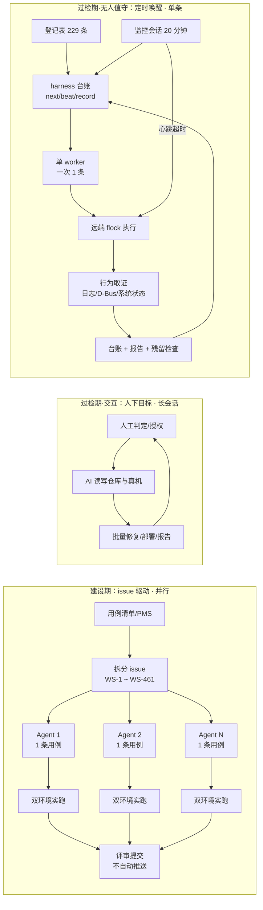
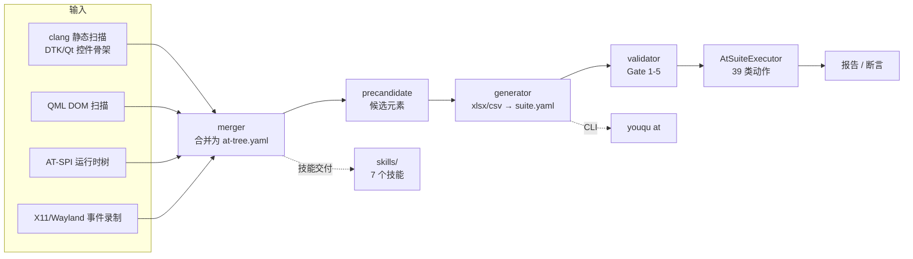
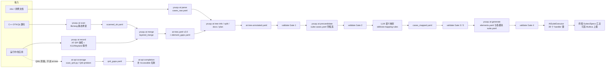
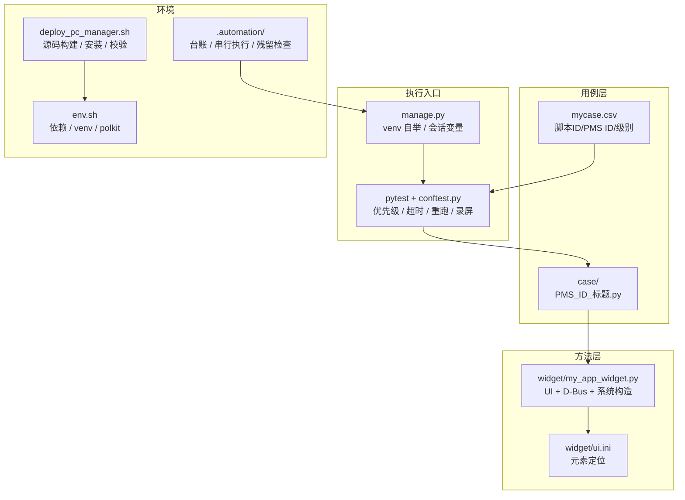

# 基于「有趣」测试框架用 AI 构建电脑管家自动化测试用例

> 项目方案总结与分享 ｜ 2026-11-18（会话归档更新至 10:37）
> 数据来源：三套本机会话存档——内部 issue 平台的 466 个建设期会话（2026-09-28 → 2026-10-26）、本机 coding agent 的 64 个过检会话（33 个顶层 + 31 个子代理/分片，2026-09-09 → 2026-11-18，全量 JSONL 归档见 `.omp-sessions/`）、DeepSeek Harness 的 212 个无人值守过检会话（2026-11-10 → 2026-11-11），以及仓库 `youqu_deepin_pc_manager`、`youqu-ai` 当前代码/文档与 2026-11-18 V20 最终全量报告（`report_2026_1018`）。
> 会话明细见本机三套存档：建设期 issue 平台导出、过检期 `.omp-sessions/`（含子代理/分片）与无人值守 harness 会话目录（均为内部资料，不外发）。
> 文中测试机统一记为 **测试机 A（V20 amd64）**、**测试机 B（V25 loongarch64）**，不记录地址、账号与密码；产品内部实现只描述行为，不引用源码路径与行号。

---

## 0. 一页速览

| 维度 | 事实 |
|---|---|
| 被测产品 | 统信电脑管家 `deepin-pc-manager`（V20 阶段 1.1.7，当前 2.14.0） |
| 测试框架 | YouQu（有趣）v2.14.0，Python PO 模式；AI 框架侧用 `youqu-ai` 2.19.8 |
| 工程规模 | 347 个用例文件、`mycase.csv` 347 行登记、`apps/` 68,011 行 Python（357 个文件；`wc -l` 68,009 + 2 个无尾换行文件）、`my_app_widget.py` 26,226 行（HEAD `7a3eae9`，2026-11-18 10:02） |
| 用例资产 | 268 条（207 条一级 + 61 条二级）；PMS 侧关联 498 条（来源 `.multica-sessions/project_summary.md`，产品 ID 555）；建设期出现 305 个任务编号（WS 系列）、235 个用例文件 |
| 提交规模 | 建设期收尾时 709 个非合并提交 + 470 个合并提交；当前仓库 745 非合并 + 473 合并（HEAD `7a3eae9`） |
| 过检结果（V20） | 229 条待过检全部结案：213 通过、15 失败、1 废弃；15 条失败中 9 条产品缺陷、2 条功能下线、3 条判据与设计不符、1 条待复验 |
| 全量结果（V25） | 361 个文件 / 362 条登记，实际执行 361 条，8.5 小时串行：224 通过（62.0%）、95 失败（26.3%）、42 跳过（11.6%） |
| 全量结果（V20 最终，2026-11-18） | 346 条：330 通过（95.4%）、3 失败（0.9%）、2 broken（0.6%）、11 跳过（3.2%）；残余 5 条 = 2 条产品缺陷（依赖修复）+ 3 条脚本缺陷 |
| 人工介入与 AI 自主（11-17 口径） | 明确界定后修正通过 20 条；点名但未给边界 54 条；无人点名 261 条中 242 条通过；点名修复实际编辑 212 个用例文件，净波及 177 条（终态差分见 §3.9） |
| 功能覆盖（develop/refactor） | 35 插件覆盖 25（71.4%）、24 个检测项 ID 覆盖 21（87.5%）、4 主页面 + 设置页全覆盖；缺口集中在 9 个修复工具、3 个检测项（`coredump` / `immutable_disk_usage` / `service_restarts`）与 1 个 V25 优化插件 |
| AI 投入（合计） | 742 个会话、1,197 条用户指令、21,841 条助手消息、36,606 次模型请求、约 26.7 亿 tokens（含缓存读） |
| 模型结构 | 过检主力：`deepseek-v4.1-flash-1017` 18,300 次（交互含子代理 14,549 + 无人值守 3,751）；建设期：`deepseek-v4-flash` 11,935 次 + `glm-5.2` 759 次；早期：`deepseek-flash` 5,051 次 |
| 核心结论 | AI 不是"生成一堆用例"，而是被约束成**可审计的逐条 worker**：领任务 → 读证据 → 改本地 → 真机实跑 → 失败归因 → 回退残留 → 记台账/评论 → 交人验收 |

一句话方案：

> **把"用例建设 + 过检"从人的手工劳动，改造成三条可审计的生产线：建设期用"issue 分片 + 多 Agent 并行"批量产出用例；过检期用"交互会话改规程/做归因 + 单入口串行 + 真机取证 + 台账"逐条闭环；无人值守批次用"定时唤醒 + 单条处理 + 监控接管"把 229 条推进到底。三者共享同一套事实源、门禁与证据链。**

---

## 1. 三条 AI 生产线与模型参与

### 1.1 参与方式不是"一个模型写代码"

本项目对 AI 的使用分五层：

| 层次              | 用法                                    | 典型工作                               |
| --------------- | ------------------------------------- | ---------------------------------- |
| 任务型 Agent（建设期）  | issue/子任务驱动，一个 Agent 领一条用例            | 版本确认、写用例、双环境实跑、提交评审                |
| 受约束 worker（过检期） | 作业规程 + 单条唤醒，5/10 分钟一拍                 | 领 1 条、改完即停、台账记录                    |
| 定时监控者（过检期）      | 20 分钟巡检 + 心跳超时接管                      | 判断 worker 是否卡死、reclaim、离线等价实现、巡检残留 |
| 交互式构建（过检期）      | 人在 coding agent 里下达目标，AI 直接操作仓库与真机    | 部署脚本、批量修复、失败归因、报告                  |
| 框架内 AI 能力       | youqu-ai 自带 MCP Server / VLM / skills | AT-SPI 元素树、YAML 用例生成、PMS 缺陷单转用例    |

### 1.2 实际参与模型与分工

按每条 assistant 消息记录的 `model`/`usage` 字段聚合（三套会话合并）：

| 模型（provider） | 请求数 | 输入 | 输出 | 缓存读 | 承担的工作 |
|---|---:|---:|---:|---:|---|
| `deepseek-v4.1-flash-1017`（uniontech-ai） | 18,300 | 53.9M | 11.5M | 1,508.1M | **过检期绝对主力**：交互式部署/用例修改/远端执行/日志归因/报告 14,549 次（含 31 个子代理/分片）；无人值守批次 3,751 次 |
| `deepseek-flash`（deepseek） | 5,051 | 10.3M | 2.32M | 464.9M | 过检期早期逐条执行、长会话默认模型；含 Product defects 归因会话 |
| `deepseek-v4-flash`（deepseek） | 12,277 | 529.8M | 6.22M | 32.2M | **建设期批量主力**（11,935 次，逐条写用例）+ 过检期部署排障（342 次） |
| `glm-5.2`（智谱） | 759 | 1.15M | 0.24M | 34.1M | 建设期 9 月的长会话：入口用例补齐、V25 验证、命名规范迁移 |
| `gpt-5.6-sol`（justdowork-openai） | 112 | 9.0M | 0.015M | 0 | youqu-ai 架构分析、wheel 安装排障（重阅读、轻生成） |
| `deepseek-v4.1-flash`（uniontech-ai） | 105 | 0.28M | 0.09M | 6.5M | 过检期早期部署与报告 |
| `claude-opus-5`（justdowork-claude） | 2 | 0 | 0 | 0 | 仅模型切换记录，未形成有效请求 |

四个观察：

1. **主力都是 flash 级模型**，不是最贵的推理模型。任务绝大多数是"读日志 → 定位 → 改一个文件 → 跑一条用例"，吞吐与工具调用稳定性比单次推理深度更重要。212 个定时会话全部由 `deepseek-v4.1-flash-1017` 完成。
2. **任务形态决定模型选择**：建设期是"短任务、海量并行"，用 `deepseek-v4-flash`；过检交互是"长会话、重工具链"，用 `deepseek-v4.1-flash-1017`；无人值守是"单轮、强规程"，仍是同一模型但每会话 1 轮；架构分析是"一次读 40k 行源码"，用 `gpt-5.6-sol` 处理 9.0M 输入。
3. **缓存复用率是成本分水岭**：过检交互缓存读占 95.7%（1.74B / 1.82B），无人值守 96.2%（268.5M / 279.1M），建设期只有 6.4%（36.7M / 573M），三条线合计 76.6%（2.05B / 2.67B）。建设期 461 个会话同日并行、每个 issue 独立冷启动，输入 token 高达 5.3 亿，几乎全部按新输入计费；无人值守每会话冷启动但单轮短，成本可控。
4. **模型切换有成本**：同一会话跨模型会丢上下文风格；后期统一主力模型后，文档与台账格式才稳定。

### 1.3 三条生产线的形态对比



| 维度 | 建设期（issue 驱动） | 过检·交互 | 过检·无人值守 |
|---|---|---|---|
| 任务来源 | 用例清单拆成 305 个子任务 | 人下达的批量目标 | 登记表 229 条 + V25 全量 |
| 并发 | 同日 461 个会话 | 单会话长跑 | 单机单 worker，另有只读巡检 |
| 上下文 | 每个 issue 独立，冷启动 | 同会话长跑，缓存 95.7% | 每会话 1 轮，缓存 96.2% |
| 人的介入 | 评论、状态流转、版本确认 | 每个决策点都在 | 只在巡检/接管/验收时 |
| 产物 | 用例文件 + 评审提交 | 修复 + 台账 + 报告 + 文档 | 用例修改 + `record` + 巡检结论 |
| 失败模式 | 版本歧义导致 blocked | 环境残留、AT-SPI 假象、超时 | 空转 busy、测试机失联、并发 reclaim |

无人值守批次不是独立阶段，而是过检期的**执行引擎**：21:35 起每 5/10 分钟唤醒一次，领到就做、领不到立即退出；交互会话负责改规程、修脚本、做归因，定时会话负责把 229 条逐条推进。212 个会话里，真正处理用例的只有 68 个，其余是 64 次忙等待、35 次环境阻断、41 次巡检、1 个监控接管、2 次鉴权失败和 1 个编排会话（68+64+35+41+1+2+1=212）——**调度开销本身就是需要设计的对象**。

### 1.4 AI 与人的分工

| 角色 | 职责 |
|---|---|
| 人 | 定验收口径、判定产品缺陷、决定版本变更用例是否下线、授权放宽判据、拒绝"改判据迎合实现"、确认版本 |
| AI | 读用例库与产品行为、构造数据、改用例/widget、双环境执行、读日志与 D-Bus、回退环境、写台账与文档 |
| 框架/脚本 | 串行锁、超时、结果解析、残留检查、报告裁剪；AI 不直接决定"通过" |

---

## 2. youqu-ai 项目介绍

### 2.1 定位

`youqu-ai` 是 YouQu（有趣）自动化测试框架的 AI 增强版（2.19.8，GPL-2.0）。传统 YouQu 提供 Linux 桌面 UI 自动化能力（AT-SPI、图像识别、OCR、键鼠、D-Bus、Web、HTTP），youqu-ai 在此基础上增加：

- **AT-SPI 源码/运行时元树 → AI 语义映射 → 可执行 YAML 套件** 的管道；
- **MCP Server**，把桌面操作暴露成 AI 客户端可调用的工具；
- **VLM 视觉**（可选，OpenAI 兼容后端）；
- **7 个 AI 技能**（SKILL.md + 脚本），覆盖用例编写、PMS 缺陷单转用例、AT-SPI 覆盖扫描等；
- **YAML 与 Python 双路径**：`youqu at` 执行声明式 YAML，`manage.py` 执行传统 PO 模式。

### 2.2 架构



详细架构


关键设计：

| 模块 | 规模 | 说明 |
|---|---|---|
| `src/` | 40,167 行 / 170 文件 | 含内嵌第三方 `src/depends/` 12,574 行 |
| `src/at` 管道 | 12,098 行 / 37 文件 | scanner 4,728、executor 3,946、generator 2,486 |
| `skills/` | 19,006 行 / 61 文件（其中 `.py` 9,616 行）/ 7 个技能 | `at-case-generator`、`at-case-from-pms`、`at-spi-coverage`、`at-case-authoring` 等 |
| `tests/` | 17,584 行（含 `tests/e2e` 298 行）/ 967 个测试函数（顶层 954 + e2e 13） | 干净环境实测 844 passed / 159 failed / 39 skipped / 6 errors |

值得借鉴的两个工程点：

1. **执行器不吞失败**：step 超时与异常统一转成 failed，不会把异常当通过；`intelligent.py` 专门解决"DTK 菜单弹出后菜单项对 AT-SPI 不可见"，按 popup id 分类后用键盘导航。
2. **技能即产品**：近 3 个月 `skills/` 的文件改动量是 `src/at` 的 6 倍以上，交付物重心从 Python API 转向"给 AI Agent 的 SKILL.md + 可执行脚本"。

同时也有需要正视的风险：

- 配置文件中曾提交明文 VLM API Key，仍在 HEAD，**应尽快轮换并移出仓库**；
- `dist/` 的 wheel 与源码脱节（2.19.8 的 wheel 缺部分技能文件），发布脚本不清理 `dist/`；
- 4 个 GitHub workflow 只做备份、chatOps、clacheck、commitlint，**没有跑测试/构建的 CI**，967 个测试长期人工触发；
- `handlers.py` 2,395 行、39 个 handler 集中在一个模块；`cli/at.py` 与 `skills/` 是两套并行实现，语义修正要改两处。

### 2.3 对本项目的实际作用

| 能力 | 在本项目中的使用 |
|---|---|
| AT-SPI 元素树/`dogtail` | Python PO 用例的底层定位基础 |
| `youqu doctor` / `env.sh` | 测试机依赖安装、AT-SPI 开启、环境自检 |
| `youqu at`（YAML 管道） | 未在本项目主链路使用，作为后续迁移方向 |
| MCP Server | 未接入日常过检；适合"AI 直接点桌面"的探索式场景 |
| `at-case-from-pms` | 方法论参考：缺陷单四要素 → 可转换性判定 → 规范用例 → 校验 → suite 增量 |
| Allure / `conftest.py` | 报告与优先级映射（本项目补了 P1–P4 → severity） |

结论：youqu-ai 提供的是"能力底座 + AI 交付形态"，本项目提供的是"一个真实产品上的完整落地样本"。两者互补，但当前过检链路仍以 Python PO + 真机执行为主，AI 负责"改与验"，不是"生成后直接信"。

### 2.4 为什么以 AT-SPI / dogtail 作为 PO 的底层定位

先厘清一个常见误解：本项目**不是运行时依赖** `youqu-ai` 仓库，而是 `youqu-startproject` 把框架源码复制进项目后本地使用。

| 对象 | 事实 | 判定方式 |
|---|---|---|
| `src/depends/dogtail/` | 与 youqu-ai 版本**逐字节一致** | `diff -rq` 无输出 |
| `src/dogtail_utils.py` | 与框架版不同，新增 222 行 / 删除 285 行 | `diff -u` |
| 运行时 import | 全部指向项目内 `src.depends.dogtail` / `src.dogtail_utils` | 用例 `from src.depends.dogtail.tree import root` |
| PO 基类 | `BaseWidget(Src)`，`Src.__init__` 组合 `DogtailUtils` | `src/__init__.py` |

所以准确说法是：**沿用 YouQu 的 dogtail 栈，库本体同源，封装层已本地分叉**。

PO（Page Object）在本项目的含义是：用例只写业务语义（`widget.click_optimization_card_by_name("大文件清理")`），元素定位、等待/重试、业务动作集中在页面方法层（`my_app_widget.py`），347 个用例不出现 selector。选 AT-SPI/dogtail 作底层，是三层约束叠加的结果：

1. **Linux 桌面没有 Win32/UIA 的等价物。** Windows 有 UI Automation、macOS 有 AX，Linux 通用的结构化控件通道是 AT-SPI（无障碍总线）。Qt5/DTK5、Qt6/DTK6、QML 都会把控件树、role、name、状态发布到这条总线上——这是 PO 能"按名字找控件"的前提。
2. **PO 需要稳定寻址，不能靠像素。** 产品的 `objectName` / `accessibleName` 直接成为定位表达式（`$//optimization_startScanBtn`、`$//optimization_cardsView//大文件清理`）；表达式可 grep、可写日志、可在失败时区分"控件改名"与"页面没到"。
3. **dogtail 是最小可用封装。** 它提供 `root.application()` 建树、`GenericPredicate` 匹配、`findChildren` 递归、`Node.click()` 与搜索超时/重试，省去手写 pyatspi 递归。项目仍保留裸 `pyatspi` 做整桌面遍历（polkit 对话框判定），说明底层是同一条 AT-SPI 总线，dogtail 只是更薄的封装。

**为什么其他通道只能辅助**（2026-11-18 对 347 个用例文件的实测）：

| 通道 | 使用规模（grep 计数） | 不能当主通道的原因 |
|---|---|---|
| AT-SPI / dogtail | 用例层 `self.dog.*` 169 次；widget 层 95 处 `find_element_by_attr` | 主通道：结构化、可按名寻址、状态可读 |
| 坐标 `ui.ini` + `ButtonCenter` | 用例层 `self.ui.` 仅 3 处 | 固定参考系 + `x,y,w,h`，动态列表、滚动、弹窗位置一变就失效 |
| `xdotool` 几何点击 | 46 个用例文件（13%） | 只用于 AT-SPI 拿不到或点不动的场景：`QTableView` 复选框由 delegate 绘制、自定义按钮 `Press` 不触发信号、V20 `:95` 虚拟显示的指针注入限制 |
| 图像识别 / OCR | 0 个用例 | 主题、DPI、毛玻璃、字体都会漂；只能证明"画面对"，读不到控件状态与层级 |
| 产品 D-Bus | 14 个用例文件 | 接口面只有系统 12 + 会话 13 个方法，覆盖不了全部 UI 行为；用于"单项结论拿不到"的取证与 `Fix` 类操作回退 |

由此形成实际的三层结构：**AT-SPI 负责操作，坐标/几何负责补洞，D-Bus/日志/X11 负责取证**。边界必须说清：AT-SPI 是操作通道，不是事实来源——"PASS 不是证据"（§6 第 3 条）。

PO 的实现偏差也要记录：标准做法是一页一个类，本项目是单个 `MyAppWidget`（26,226 行）。它保留了 PO 的核心收益（用例零 selector、定位变更只改一处），但丢了对象边界，代价是单文件耦合与并行修改冲突（公共层同一时刻只允许一个 owner，否则合并冲突会吞掉别人的改动）。

### 2.5 本项目对 youqu-ai dogtail 栈的修改与收益

`src/dogtail_utils.py` 相对框架版的差异是 **+222 / −285 行（`diff` 输出统计，净 −63）**，分两类。

**A. 诊断增强（新增）**

| 新增 | 作用 |
|---|---|
| `_lookup_caller()` | 记录调用点 `文件:行号:函数`，未命中时直接跳到出问题的用例行 |
| `_lookup_log()` | 统一单行结构化日志：四态结果（直接命中 / 真实未命中 / 候选命中 / 候选未命中）、`expr`、`count`、`name/role/size`、`cost`、`caller` |
| `_lookup_tree_diag()` | 未命中时扫一遍 AT-SPI 树：目标 name 是否存在、匿名控件（未设 name）数量与角色分布/文本采样、遍历节点数、`difflib` 近似名（cutoff 0.6，最多 5 个） |
| `log_lookup_summary()` + `set_current_case()` | 会话结束按"表达式"和"用例"两个维度汇总未命中 |
| `probe` 参数 | 区分"多候选回退的探测未命中"（V20/V25 双写，属预期）与"真实未命中"，避免汇总误报 |

典型日志（单行，可 grep；`caller` 为占位）：

```text
[控件查找] 结果=真实未命中 hit=0 probe=0 expr=$//repair_runtimePage//开始修复
           count=0 cost=0.41s caller=<widget 文件>:<行>:<方法>
           目标name='开始修复' 同名控件=无 匿名控件=48 已命名控件=187
           匿名文本=[label]'磁盘工具' 遍历节点=331
```

对应的问题是：过检期最常见的失败是"找不到控件"，但原实现只抛 `ElementNotFound`，无法区分元素名写错、页面没到、控件匿名、V20/V25 双写探测失败。改造后用 63 条用例批量验证，单条日志足以定位（见 §4.3 坑 6）。

**B. 精简与兼容（删除）**

| 项目版差异 | 说明 |
|---|---|
| 无 `require_visible=True` / `active_frame_only=True` 默认过滤 | 与 V20 QML `showing` 恒 False 的现实一致；可见性改由断言层 `_any_visible()`（`size != (0,0)`）判断，避免查找阶段全部假阴性 |
| 无 `find_elements_by_accessible_id()` / `find_element_by_accessible_id()` | 定位统一走 name 层级，减少多帧环境下的不确定性 |
| 无 `_node_matches_accessible_id()` / `_active_frame_extents()` / `_gi_find_descendants()` | 去掉 PyGObject 直接遍历 AT-SPI 判定活动帧的复杂路径，回到 dogtail 朴素递归 |
| 无 `config.actionDelay` 等 | 精简启动参数 |

**收益与代价**

| 收益 | 证据 |
|---|---|
| 失败可定位 | 一行日志回答"元素名写错 / 页面没到 / 匿名控件 / 近似名"；63 条批量验证 |
| 汇总可量化 | 表达式维度 + 用例维度的未命中统计进入过检报告，可定位高频失效表达式 |
| 语义正确 | `probe` 未命中不计入"找不到控件"，V20/V25 双写不再污染失败归因 |
| 兼容 V20 QML | 去掉可见性过滤后假阴性消失，可见性判断下沉到断言层 |

| 代价 | 影响 |
|---|---|
| 与上游漂移 | 框架升级时约 500 行差异需手工 rebase；框架新增能力（如 accessible-id 查找）项目没有 |
| 能力缺口 | 只暴露 Qt `accessibleId()` 而不暴露 `name` 的控件无法定位 |
| 回归归属 | 分叉代码的测试依赖项目自身 347 条用例，框架侧无对应回归 |

结论：选型不是"选了一个库"，而是在 Linux 桌面通用的结构化控件通道上做**可诊断的封装**；真正的工程量在封装层的日志、回退与取舍，而不是调用 `find_element` 本身。

---

## 3. youqu_deepin_pc_manager 项目介绍

### 3.1 目标与范围

用 YouQu 对电脑管家做桌面 UI 自动化，覆盖：

- 系统检测（系统环境/更新环境/硬件/网络四大分项）；
- 系统优化（空间清理、垃圾清理、大文件/重复文件、启动项）；
- 修复工具（系统修复、桌面修复、第三方应用修复、外设/USB、打印机、音频）；
- 实用工具、性能（valgrind）、埋点、启动器/任务栏等系统集成场景。

用例来源是 PMS 用例库与过检登记表，**登记表是编号与优先级的唯一事实源**。

### 3.2 建设期：从 12 条入口用例到 300+ 条

| 时间 | 阶段 | 关键动作 |
|---|---|---|
| 2026-08 | 方案评审 | 对"免鉴权方案""1.1 新增检测项与修复工具"等设计材料做评审，结论拆成 issue 跟踪 |
| 2026-09-11 | 仓库起点 | Initial commit |
| 2026-09-28 | 规范迁移 | 12 条入口用例从 `test_mycase_0XX.py` 统一改名为 `PMS用例ID_用例标题.py`；补 全局/入口 12 条、网络检测 19 条、系统完整性检测 12 条；在测试机 B 上验证 |
| 2026-10-08~10 | 批量建设 | 用例清单拆成任务编号（WS-1 ~ WS-461，会话中出现 305 个），同日 461 个 Agent 会话；每条用例先确认 V20/V25，再写脚本、双环境实跑、提交评审 |
| 2026-10-26 | 建设收尾 | 709 个非合并提交、470 个合并提交；用例资产 268 条（207 一级 + 61 二级） |
| 2026-11-10 20:32 | 无人值守开跑 | 编排会话 `f751542f` 启动；`单条处理` 10 分钟、`监控恢复` 20 分钟的定时批次开始领条 |
| 2026-11-11 11:35 | 批次暂停 | 最后一个定时会话结束；212 个会话、39 通过 / 35 失败（含环境阻断），编排会话写出《自动化过检-进展总结-20261111》 |
| 2026-11-12 | 过检定稿 | 229 条：213 通过 / 15 失败 / 1 废弃；15 条失败全部有证据链 |
| 2026-11 | V25 全量 | 登记 362 条、执行 361 条，8.5 小时串行：224 通过 / 95 失败 / 42 跳过；后续在独立工作树修复 |
| 2026-11-17 | V20 全量复跑 | 346 条（result 汇总）：315 通过 / 21 失败 / 1 broken / 9 跳过；`detail_report.json` 345 文件为 314/22/9（broken 记 fail、缺 061 方法）；21 条失败进入 Product defects 归因分析 |
| 2026-11-18 | V20 全量终态 | 02:17–06:49 复跑：330 通过 / 3 失败 / 2 broken / 11 跳过；21 条失败收敛到 5 条残余（2 产品缺陷、3 脚本缺陷），7 条重跑中仅 1 条转通过 |

建设期的数据规模（本机导出会话统计）：

| 指标 | 数值 |
|---|---|
| 会话数 | 466（其中 461 个在 2026-10-10 同日） |
| 用户评论/指令 | 494 |
| 助手消息 | 12,694 |
| 模型请求 | 12,694（`deepseek-v4-flash` 11,935 / `glm-5.2` 759） |
| 总 tokens | 573.5M（输入 530.5M、输出 6.27M、缓存读 36.7M） |
| 子任务编号 | 会话中共出现 305 个不同编号（WS-1 ~ WS-461） |
| 涉及用例文件 | 235 个（会话文本中出现的 `ID_标题.py` 去重） |
| 阻塞 | 77 个会话出现 `blocked` 状态变更；385 个会话命中"版本未确认"关键词（按文本计数，非逐条人工核验） |

无人值守批次的数据规模（`.dsh/sessions` 中 cwd 命中本项目的 212 个会话）：

| 指标 | 数值 |
|---|---|
| 时间范围 | 2026-11-10 20:32 → 2026-11-11 11:35 |
| 会话类型 | 单条处理 167（recorded 68 / busy 64 / 环境阻断 35）、监控巡检 41、监控接管 1、编排 1、鉴权失败 2 |
| 轮次 / 工具错误 | 218 / 53 |
| 用例记录 | pass 39 / fail 35（70 个会话，覆盖 65 条用例，含重试） |
| 当时台账 | 39 通过 / 26 失败 / 164 待处理（11:37）；最终 passed 223 / failed 4 / pending 1 / skipped 1（11-16） |
| 助手消息 / tokens | 3,751 / 279.1M（输入 7.76M、输出 2.83M、缓存读 268.5M） |
| 代码改动 | 64 个文件、+24,159 / −9,990 行 |
| 通过用例运行次数 | 均值 1.69 次 |

### 3.3 规模

| 指标 | 数值 |
|---|---|
| 用例文件 | 347 个（当前；建设期收尾时 348） |
| `mycase.csv` 登记 | 347 行 |
| 用例级别 | P1 81 / P2 131 / P3 115 / P4 19 / 未填 1 |
| `apps/` Python | 68,011 行 / 357 个文件（`wc -l` 68,009 + 2 个无尾换行文件） |
| `my_app_widget.py` | 26,226 行（页面方法层，PO） |
| 仓库提交 | 745 个非合并提交 + 473 个合并提交（HEAD `7a3eae9`） |

### 3.4 结构



### 3.5 部署链路（本项目最值得复用的部分之一）

`deploy_pc_manager.sh` 做的不只是"装包"，而是把测试环境的全部前提编码：

1. 按系统能力探测写 apt 源（V20/V25 不同源），备份后**保持生效**，隔离不匹配的源列表，避免构建期把基础库/SSH 服务连带升级；
2. 自动识别 V20（Qt5/DTK5）或 V25（Qt6/DTK6），处理开发包版本约束、DTK soname、`lrelease` 路径；
3. 从内部代码评审平台拉源码构建最新提交，**构建失败直接报错，不静默回退仓库旧版**；安装后校验版本与源码一致；
4. polkit 预授权（两套后端：pkla / rules_js），修策略文件权限，让 UI 自动化能跨过系统认证弹窗；
5. 安装用例依赖（`iputils-arping` 等）；
6. `.venv` 只装框架依赖，**不写系统 site-packages**；把 `.venv/bin` 前置到 PATH，`manage.py` 发现解释器不在 venv 时自动 `execv`；
7. V25 额外处理 PEP 668、`packaging` 无法卸载、`setuptools≥81` 移除 `pkg_resources`、`/usr` 只读 overlay。

### 3.6 用例组织与判定

- **一条用例一个文件**：`PMS用例ID_用例标题.py`；方法名、csv 编号、文件名前缀三者必须一致，否则 `-k` 跑错对象。
- **PO 模式**：页面方法集中在 `my_app_widget.py`，用例只做"构造 → 操作 → 断言 → 回退"。
- **判定口径**：精确数值不要求逐字匹配，但必须有等价断言；核心是按描述构造数据并走完整流程；每条必须闭环、测试机零残留。
- **禁止**：`pytest.skip` 逃避、`pass` 占位、只 `sleep` 不断言、`assert True`。
- **分级进入报告**：`conftest.py` 把 csv 的 P1–P4 映射为 Allure `BLOCKER/CRITICAL/NORMAL/MINOR`，修复了"优先级恒 normal"。

### 3.7 自动化过检骨架（`.automation/`）

| 文件 | 作用 |
|---|---|
| `manifest.json` | 228 条待过检清单（台账 229 中的 1999071 未入清单），内嵌用例库前置/步骤/预期 |
| `harness.py`（361 行） | `next / case / beat / record / release / status / export / requeue-failed`；文件锁 + owner 心跳保证串行 |
| `PROCEDURE.md` | worker 作业规程：身份、铁律、判定标准、失败上限、收尾、禁止提问 |
| `MONITOR.md` | 心跳超时 → 核查 → 回收 → 接手 |
| `scripts/run_case.sh` | 同步 → 远端加锁执行 → 结果判定 → 残留检查 → 报告裁剪 |
| `scripts/remote_run.sh` | 测试机侧 `flock` + 默认 1500s（可覆盖）超时 + 前后清理应用进程 |
| `scripts/remote_check.sh` / `remote_clean.sh` / `remote_prune.sh` | 残留检查 / 清理 autotest 对象 / 报告裁剪 |
| `ledger.json` / `history.jsonl` | 逐条状态台账 / 全量事件流水 |

### 3.8 结果

| 阶段 | 结果 |
|---|---|
| V20 单用例过检（229 条） | 213 通过 / 15 失败 / 1 废弃（11-12 定稿）；15 条失败：9 产品缺陷、2 功能下线、3 判据与设计不符、1 待复验，全部有日志/截图/行为证据；未改产品源码、未为迎合实现改判据。11-13~16 继续修复复验后，台账（`ledger.json`）终态为 223 通过 / 4 失败 / 1 跳过 / 1 待处理，同一 229 条 |
| V20 后续修复 | 3 条删埋点断言，改为"进入运行时页 + 扫描/结果页/启动项列表加载"并真机 PASS；1 条改判"免鉴权直修成功"并留 daemon 日志证据；valgrind 单轮 318→74s；1 条收尾 230s 内通过 |
| V25 全量（登记 362 条 / 执行 361 条） | 8.5 小时串行：224 通过 / 95 失败 / 42 跳过；失败主题：清理 31、其他 23、第三方应用修复 10、系统检测/更新 8、音频 8、打印机/权限 6、外设 USB 5、网络/仓库 4 |
| V25 修复 | 在独立工作树按最小改动继续；17 条"旧通过→新失败"用 5 组对照（稳定性/会话变量/启动方式/AT-SPI 残留/daemon 状态）排除了代码原因，定位为测试机重置后的干净基线差异 |
| 无人值守批次（212 会话） | 会话级 `record` 为 39 通过 / 35 失败（含同一用例重试）；台账 26 条失败中 **21 条是测试机失联误判**（SYNC/SSH 失败仍写了 `fail`），5 条真实失败（产品缺陷 3、环境限制 1、待复跑 1）；04:12 起测试机失联，之后 44 条用例只能离线等价实现或阻断。35 是会话级记录（70 个会话、含重试），26 是台账按用例去重后的条数；两者同减 21 条误判，分别对应 14 次会话级真实失败与 5 条用例级真实失败 |
| 批次收尾 | 编排会话给出 P0：重置 22 条误判（21 条失联 + 2005699 被标"不可达"但实为功能下线）、加固 SYNC/SSH 失败判定、恢复定时任务；P1：跑完 164 条（约 24h）；P2：二轮复检与差异清单 |
| V20 全量终态（2026-11-18） | 346 条：330 通过 / 3 失败 / 2 broken / 11 跳过（02:17–06:49）。相对 11-17：16 条 fail→pass、2 条 fail→skip（107/110 改判"公网不可达属前置不满足"）、4 条仍 fail，另 371 由 pass→fail（新增构造时序回归）。残余 5 条：145/146 为依赖修复插件未检查 `apt install -fy` 返回码（产品缺陷，同一根因）；371 断言时扫描任务已是 `success:ok`（返回动作未落入扫描期，构造时序问题）；055 `sleep` 未导入、319 调用 widget 不存在的 `set_unreachable_repo`（脚本缺陷）。7 条重跑中仅 333 由 failed 转 passed，其余 6 条重跑后仍非通过。11 条跳过：环境/硬件/网络不可构造 9（含 320 为 V25-only、298 存在可升级包）、产品未实现 1（099 系统代理）、并发保护 1（067） |

三个条数口径对应不同时点：**347** 是当前 `mycase.csv` 登记；**362** 是 2026-11-05 V25 时的登记（实际执行 361 条，224+95+42=361）；**346 / 345** 是 2026-11-18 V20 终态（allure 聚合 346 个方法，`detail_report.json` 按文件记 345 条：`2005451_电脑管家--功能模块.py` 含 274、061 两个方法；明细无 broken 分类，055/319 记 fail）。期间有废弃（2005479 按新判据复跑通过后保留为废弃记录）与新增用例，属正常增删，不是统计误差。

### 3.9 人工介入与 AI 自主：点名、修正与批量波及（11-17 全量口径）

口径：以 `report_2026_1018/report/json/detail_report.json` 的 345 条最终状态为基础（allure 聚合 346 个方法，差额为 2005451 的第二方法 061；明细无 broken 分类），与 11-16 前存档的 25 个顶层交互会话的用户提示词交叉（11-18 归档已扩至 33 个顶层 + 31 个子代理/分片，增量见本节末）。"点名"指用户提示中出现用例 ID 或 `test_mycase_XXX`，且给出边界、期望、构造方式或明确要求修复。

**三分：谁把用例推到通过**

| 分组 | 点名 | 通过 | 失败 | 跳过 |
|---|---:|---:|---:|---:|
| A. 明确界定（给出判据/期望/构造） | 30 | 24 | 5 | 1 |
| B. 只点名修复，未给边界 | 54 | 48 | 5 | 1 |
| C. 未点名 | 261 | 242 | 12 | 7 |
| 合计 | 345 | 314 | 22 | 9 |

> 表内是 11-17 `detail_report.json` 的 345 文件口径（314/22/9）；11-18 终态同口径为 329 通过 / 5 失败 / 11 跳过（allure 346 方法另含 2 broken 与 061 通过）。差分：通过 +15、失败 −17、跳过 +2，15 = 17 − 2。残余 5 条中 145/146 属依赖修复产品缺陷、371/055/319 属脚本缺陷，逐条见 §3.8。

- A 组 30 条中，严格给出判据/期望/构造方式的 20 条（其中 2 条是只纠正映射或启动方式的条目）；另 4 条只有"太慢""卡住"诉求，介入强度按 B 类计，已从 20 条判据型中剔除。
- C 组 242 条通过再拆：**125 条**过检期由 AI 自行改实现后通过、**63 条**未改代码直接通过、**54 条**不在 V20 229 条台账内直接通过。
- 结论：**明确界定后修正通过 20 条（占全量 5.8%）；AI 无人点名边界、最终通过 242 条（70.1%）**。

**20 条明确界定按类型**

| 类型 | 条数 | 代表用例 |
|---|---:|---|
| 截图给出应显示内容/期望文案 | 5 | 1999101、1999121、2000545、2001659、2001729 |
| 明确"应该执行 X 检测" | 3 | 1998969、1999063、2005875 |
| 明确启动方式 | 2 | 2000531、2000533 |
| 放宽或修正判据 | 4 | 1999131、2000543、2005479、2032457 |
| 明确期望行为 | 2 | 2001957、2001989 |
| 明确前置需构造的场景 | 3 | 1998997、2005459、2005461 |
| 纠正用例与需求映射 | 1 | 2032309 |

**点名修复的批量外溢**

| 指标 | 数值 |
|---|---:|
| 人工直接点名用例 | 84（A 30 + B 54） |
| 点名用例自身被编辑 | 35 |
| 修复轨迹实际编辑用例文件（去重） | 212（占 347 条的 61%） |
| 点名单以外净波及 | 177 |
| 公共层被改文件 | 14（`my_app_widget.py`、`conftest.py`、`dogtail_utils.py` 等） |

| 触发机制 | 点名 | 实际编辑 |
|---|---|---:|
| 修复流程弹窗卡死 → 统一收尾 `finish_repair_flow` | 2 | 11（桌面/应用/打印机修复族） |
| V25 失败批量修复 → FixSlice0–5 分片 | 批次指令 | 119（19–21 条/片） |
| "IP 冲突用例先跳过，最后统一处理" → 网络类批量改造 | 0（指令级） | 44 |
| 打印机族（权限 / dde-printer 版本） | 2 | 14 |
| 音频修复族（Sink/Source/ALSA） | 0（族指令） | 13 |
| USB 修复族（FAT32/exFAT/ext4） | 0（族指令） | 11 |
| 实用工具 / 扫描分区族 | 2 | 9 |
| 鉴权超时族 | 1 | 5 |
| 重复文件"智能选择"根因 | 0（族指令） | 3 |
| 检测首页多类型异常 | 1 | 4 |
| ReviewGroup 自主审查 | 0（"继续"） | 60 |

- 点名数不能当工程量：84 条点名触发了 212 个用例文件的编辑，按改动面积算约为点名数的 2.5 倍。
- 公共层改动对所有用例横向生效，无法按单条归属；统计 212 是下限（`edit/write` 路径口径，整目录循环 `sed` 未完全计入）。
- 反向证据同样重要：A 组 30 条点名中仍有 6 条失败/跳过，说明"人给了边界"不等于"实现必然通过"，最终仍以真机结果为准。
- 归档增量（2026-11-18 10:37 更新）：过检会话由 25 个扩到 33 个顶层 + 31 个子代理/分片。新增 8 个顶层会话中，youqu-study 仓库 3 个（压缩/提交）、会话汇总 2 个、report 统计 1 个、提交信息 1 个、Product defects 归因 1 个；带新边界判据的只有 Product defects 归因会话 `01a1e867`（11 轮，`deepseek-flash`）：011/297 把启动器右键坐标改为按搜索结果动态定位（定性为用例缺陷：剪贴板无 owner 导致粘贴为空）、216/053 startup notification 用户名口径建议改为修判定规则（记录的是软件源地址）、107/110 依赖公网保持 skip。三条均已在会话内改完用例并复跑，未并入上面的 A/B/C 分类。
- 子代理/分片（FixSlice0–5、ReFix*、ReviewGroup*、Fix*Cluster、SourceSurface/CaseSurface）共 31 个，用户提示为任务派发而非人工判据，因此不计入点名统计，只计入请求与 token。

### 3.10 测试覆盖分析：用例资产 × 产品功能面（develop/refactor）

口径：**功能/接口级覆盖**，不是代码行覆盖率——产品侧未接 gcov/lcov 插桩。被测源码取 `deepin-pc-manager` 的 `develop/refactor` 分支（插件化重构后架构，与线上 2.14.0 存在差异）；用例侧取当前 347 个用例文件中的 345 个可执行模块。功能面枚举与用例归类分别由两个只读子代理完成，归档见 `.omp-sessions/sessions/…SourceSurface…`（`01a1ec6b-643f`）与 `…CaseSurface…`（`01a1ec6b-6449`）。

**产品功能面（源码事实）**

| 层 | 规模 | 关键入口 |
|---|---|---|
| GUI 主程序 | 4 页面 + 设置对话框 | `detection/optimization/repair/utility`，`--page` 跳转 |
| 插件 | 35 个 | detection 5、optimization 5、repair 21、utility 4 |
| 系统守护进程 | 12 个 D-Bus 方法 | `Detect/Fix/CleanSpaceCleanItems/DeleteMediaFilesPermanently/WriteHosts/RunRepairTool(WithToken)` 等 |
| 会话守护进程 | 13 个 D-Bus 方法 | `Detect/Fix/Start*Scan/Stop*Scan/Delete*/ExecuteUserAction/Navigate` |
| 可操作项 ID | 29 个常量（29 个唯一值；系统 15 + 会话 14），其中 24 个带检测语义 | `operable_item_ids.h` |
| 检测器 / 交互 / 埋点 | 8 个 / 7 类弹窗 / 2 个 TID | system、stability、update、hardware、network、space_clean、large_file、duplicate_file |

**覆盖总览**

| 维度 | 覆盖 | 比例 |
|---|---:|---:|
| 插件（35） | 25 有用例，10 无用例 | 71.4% |
| 修复类插件（21） | 12 覆盖，9 未覆盖 | 57.1% |
| 检测类插件（5） | 5 覆盖 | 100% |
| 检测项 ID（24） | 21 覆盖，3 未覆盖 | 87.5% |
| 优化类插件（5） | 4 覆盖 | 80% |
| 工具类插件（4） | 4 覆盖 | 100% |
| 主页面 + 设置对话框（5） | 5 覆盖 | 100% |

**按页面覆盖矩阵**（A 专项含主路径+异常，B 主路径为主，C 仅入口，D 无用例）

| 页面 | 插件/功能 | 用例数 | 级别 | 主要缺口 |
|---|---|---:|---|---|
| 体检 | syscheck / updatecheck / hardwarecheck / networkcheck | ~108 | A | — |
| 体检 | stabilitycheck | 7 | B | `coredump`、`service_restarts` 零用例 |
| 优化 | space-clean / large-file / duplicate-file | ~56 | A | 应用垃圾逐项缺专项；“打开文件所在位置”缺 |
| 优化 | startup 启动项管理 | 1 | C | 无逐项启停/筛选/空态 |
| 优化 | immutable-disk-usage 磁盘占用 | 0 | D | 旭日图/分类/导出全缺（V25/ostree） |
| 修复 | 微信/企微/QQ/WPS/输入法、音频/打印机/USB、依赖修复 | 58 | A | — |
| 修复 | 网络修复、长文件名、密钥环 | 5 | B | — |
| 修复 | app-crash / app-font / app-startup / app-store / cache-clean / system-update / icon-display / launcher-fix / taskbar-fix | 0 | D | 9 个修复工具零用例 |
| 修复 | 修复页框架（分类/搜索/弹窗/提权） | 13 | A | 密码输入框专用路径未见 |
| 工具 | hosts-editor / disk-manager / disk-usage / log-viewer | 17 | B | 未安装安装流程部分覆盖 |
| 全局 | 入口/托盘/任务栏/快捷方式/帮助、兼容/性能/安全/压测 | 80 | B | 单实例 `--page` 跳转、埋点计数无断言 |

**检测项 ID 缺口**：系统侧 `coredump`、`immutable_disk_usage`；会话侧 `service_restarts`。

**接口与协议覆盖**

| 类别 | 结论 |
|---|---|
| 直接 D-Bus 调用 | 仅 4 个：`Detect`、`Fix`、`Task.GetResult`、`Task.GetStatus` |
| UI 端到端触达 | 约 18/29 个可操作项（29 个常量口径；扫描/清理/删除/hosts/修复脚本/鉴权均经 UI 间接覆盖，18 为按用例实际触达的估算）[INFERENCE] |
| 未覆盖接口 | `SetAllowCaller`、`CancelDetection` 边界、`CancelRepairTool`、`WriteScriptInput` 协议边界、`CancelScriptInput`、`Navigate` |
| 鉴权 | 覆盖较好：无需鉴权/需鉴权/鉴权超时（2032437/2032439/2032441/2032443） |
| 错误码 | 断言以 UI 文案/状态为主，未直接断言 `ResultCode` 码表 |
| 插件 ABI / 离线导入 | 0 用例 |

**结论与补测优先级**

主干功能覆盖扎实：体检 5 卡、空间/大文件/重复文件、外设与应用修复、修复页框架、工具页均为强覆盖；缺口集中在**修复工具长尾**与**稳定性/优化页少数子项**，不是主流程缺失。

| 优先级 | 补测项 |
|---|---|
| P1 | 启动项管理逐项启停/筛选；`cache-clean`、`system-update`、`app-store`、`launcher-fix`、`taskbar-fix` 五个修复工具；大文件/重复文件“打开文件所在位置” |
| P2 | `coredump`、`service_restarts` 检测项；`immutable-disk-usage`（V25 旭日图）；`app-crash`、`app-font`、`app-startup`、`icon-display` |
| P3 | `ResultCode` 错误码断言、`SetAllowCaller`/`Cancel*` 接口边界、埋点 TID、离线插件导入与插件 ABI、设置页旧配置迁移/启动项建议模式 |

---

## 4. 构建和优化过程中踩了哪些坑，怎么解决的

以下每条都来自会话中的实测记录；只写有日志、复跑结果或行为观察支撑的结论。

### 4.1 建设期（issue 驱动并行）的坑

| # | 现象 | 根因 | 解决 |
|---|---|---|---|
| 1 | 大量用例任务被置为 `blocked`，同批任务连环阻塞 | 用例清单只有 ID/标题/模块/优先级，没有 V20/V25 版本字段；Agent 的作业规程要求"版本不明确必须暂停询问"，于是同批 4 个以上任务同时阻塞 | 承认这是**正确的门禁行为**，不是 Agent 偷懒；人在评论中一次性明确"V20、V25 都支持"，随后任务批量解除、补跑双环境。**经验：批量任务开工前先把版本维度补进清单，别让 N 个 Agent 分别问你同一个问题** |
| 2 | 用例在 V20 的虚拟显示（`:95`）上点击无反应、窗口被立即关闭 | 两处叠加：①AT-SPI 的指针注入绑定在注册器自己的 display（`:0`），在 `:95` 上生成的鼠标事件实际点到了 `:0`；②把应用挂到完整会话环境（`DISPLAY=:0`）会被窗口管理器立即关闭 | 读树与指针事件分离：读树跨 display 可用，指针注入必须同 display；非 `:0` 时改用 AT-SPI `Action.Press` 语义点击（封装为 shim），不再依赖 `xdotool`；`manage.py` 增加 `TEST_DISPLAY` 变量贯穿执行链路；裸启动辅助与进程匹配同步加固。实测 V20 amd64（Xvfb `:95`）单条 27s、V25 loongarch64（默认 display）单条 51s |
| 3 | 同一用例在 V25 上"读不到文案" | V25 的 QML 节点向 AT-SPI 暴露的文本为空，但 `showing`/结构可用 | 断言改用 AT-SPI `showing` 状态 + 结构关系（按钮存在/汇总态图标切换/列表项出现），不依赖节点文本；确需文案时从产品 D-Bus/日志取 |
| 4 | 同一功能在 V20 与 V25 上判定不一致 | 架构从 amd64/Qt5 迁到 loongarch64/Qt6，控件树、依赖包、默认 display 行为都变 | 每条用例显式标注适用版本；不适合的版本用 `skipif` 并写明原因；双环境各跑一遍，差异写进用例 docstring，不写"两版都通过"的模糊断言 |
| 5 | 测试机 B 环境不稳定（超时、连不上、窗口不开） | 长跑、反复装包、图形会话被重置 | 执行前先做连通性与环境自检；失败先重试一次并记录；环境恢复后从断点继续；不把"环境没起来"算作用例失败，也不静默跳过 |
| 6 | 并行任务互相踩工作区/分支 | 461 个会话同日运行，工作区、缓存、测试机都是共享资源 | 每个任务独立工作区（导出数据显示 465 个会话运行在独立 immutable 工作区）；提交走评审、不自动推送；测试机侧加锁，冲突时排队而不是抢跑 |
| 7 | 用例命名与清单对不上，`-k` 选错对象 | 早期文件名是 `test_mycase_0XX.py`，与 PMS ID 无映射 | 迁移为 `PMS用例ID_用例标题.py`；csv、方法名、文件名三方一致性校验；改名后全量 `--collect-only` 验证唯一性 |
| 8 | 批量会话成本高、缓存几乎不复用 | 每个 issue 独立冷启动，输入 token 5.3 亿、缓存读只占 6.4% | 接受这是并行的代价；把"公共上下文"（版本规则、命名规范、环境说明）前置到任务模板里，减少每个 Agent 的探索轮次 |
| 9 | 任务材料（用例清单/附件）拿不到或不完整 | 清单分散在 PMS 与附件里，Agent 需要先抓取再判断 | 先把清单固化成仓库内可读文件（csv/xlsx），任务里只给范围与 ID；抓取失败时记录缺失项，不猜 |

**建设期最重要的经验**：**并行 Agent 的瓶颈不是写代码速度，而是"信息是否足够开工"**。版本、环境、入口、命名四件事只要有一件含糊，N 个 Agent 就会产生 N 次阻塞。把这些信息变成清单字段和任务模板，比换更强的模型有效得多。

### 4.2 部署与环境

| # | 现象 | 根因 | 解决 |
|---|---|---|---|
| 1 | 部署脚本报编译器依赖冲突，最终装成仓库旧版，用例覆盖不到新功能 | V20 的 Qt5/DTK5 运行时是带签名后缀的版本，仓库开发包要求精确同版本 | 编译器元包按 V20 基线降级（只降元包）；Qt5/DTK5/GL 开发包解包到 `/usr`，不注册 dpkg 依赖；按 V20 控制文件打包；构建后校验版本；**失败不静默回退** |
| 2 | 测试机装包后基础库/SSH 服务被升级，SSH 失联 | 机器上混入另一版本源，构建期 `apt install` 连带升级 | 装包前按系统版本写源；隔离不匹配的源列表；备份到独立目录；部署期间保持源生效不还原 |
| 3 | V25 `pip` 报 `externally-managed-environment`；`pipenv` 装不上；`pytest-rerunfailures` 导入崩 | PEP 668；Debian 包无 RECORD；`setuptools≥81` 移除 `pkg_resources` | 能力探测而非版本号分支：pip≥23 加 `--break-system-packages`，统一加 `--ignore-installed`，固定 `setuptools<81`，剔除 apt 已提供的同名分发包；`/usr` 只读时 remount 可写 overlay |
| 4 | V25 检测项 D-Bus 报 `AccessDenied: Authorization denied` | V25 没有旧版 polkit 本地授权目录，预授权被静默跳过 | 双后端：目录探测 pkla / rules_js；写规则文件；`pkcheck` 自检；预授权放在产品安装后（action 安装后才注册）；`pkcheck -u` 不是"指定用户" |
| 5 | SSH 启动的电脑管家左侧栏毛玻璃消失、主题/图标漂移 | 裸 SSH 环境缺桌面/平台变量，DTK 不申请模糊区域 | `manage.py` 用 `setdefault` 补会话变量；按显示服务器类型决定是否强制 `QT_QPA_PLATFORM`；用窗口属性验证模糊区域存在 |
| 6 | 电脑管家报"关键库依赖问题"，被误判为用例没回退干净 | 测试项目把 numpy/Pillow/cryptography 等 39 个同名 `.so` 写进了系统 site-packages，与 apt 包冲突 | 框架依赖只装 `.venv`；`.venv/bin` 前置 PATH；`manage.py` 自动 `execv` 到 venv；部署脚本同步依赖时剔除 apt 同名包 |
| 7 | 测试机无 `sshpass`、V25 无外网，apt/pip 全部失败 | 环境限制 | 宿主机起正向代理并写 apt 配置；用 paramiko/rsync/包装脚本替代 sshpass；部署脚本把代理作为可覆盖项 |
| 8 | Allure 套件列表中文乱码 | `conftest.py` 对 nodeid 做了双重 `unicode_escape` | 删掉两行转换；项目仓与 youqu-ai 框架仓同步修；重新构建 wheel（`dist/` 里会残留旧 wheel） |
| 9 | 报告里单条用例优先级恒为 `normal` | 只用了 Allure 的 `L1–L4` 枚举，csv 里是 P1–P4 | `conftest.py` 增加 P1–P4 映射；重跑后 P1/P2 显示 blocker/critical |

**经验**：不要按 OS 大版本写 if/else，按**能力探测**（pip 版本、polkit 目录、`/usr` 是否 overlay、显示服务器类型）。版本号只用于报告标注与错误提示，不参与安装逻辑。V20/V25 分支越多，没机器验证的那一支腐烂得越快。

### 4.3 产品行为与 AT-SPI 能力边界

| # | 现象 | 根因 | 解决 |
|---|---|---|---|
| 1 | 用例 PASS，但用户观察到"根本没执行检测" | QML/AT-SPI 的 `showing` 在部分节点恒为 `False`；等待函数用它判断且丢弃返回值 | 可见性一律用 `size != (0,0)`；新增"点击后必须看到运行态/结果态"的等待；封装 `_any_visible()` |
| 2 | 单项检测结论读不到 | V20 QML 的 Label/ListView 不向 AT-SPI 暴露文本与单项状态，只有分项问题总数 | 走产品自身 D-Bus：检测任务 → 结果查询；会话总线不认识时回退系统总线；两条都不实现才退回分项级断言 |
| 3 | 用例停了很久，daemon 日志里却没有收到请求 | AT-SPI `Press` 被产品忽略（不是弹窗阻塞、不是鉴权失败） | 有界重试点击；点击后必须看到目标对话框/输出，否则重试而不是无限等 |
| 4 | 断言早过了，用例 400–500s 才结束，甚至被外层 timeout 杀掉 | 修复完成弹窗永不自动消失，`exec()` 一直阻塞 | 每轮看到弹窗就点，不依赖正文；命中关键字或修复窗口不可见即返回；统一收尾并在进程清理时兜底 |
| 5 | 弹窗断言写成"等正文出现再关" | DTK 标签的 AT-SPI `name` 是对象名，正文读不到 | 断言"弹框存在 + 标题 + 按钮文案"；正文从会话总线消息请求参数取；窗口关闭用 X11 标题判定（AT-SPI 节点销毁后仍报 `showing=True`） |
| 6 | 找不到控件，但不知道是元素名写错还是回退命中 | 控件查找有多级回退，旧日志只打印成功 | 统一日志：区分"候选回退 / 真实未命中"，未命中打印匿名控件文本，一行可 grep；批量跑 63 条用例验证日志足以定位问题 |
| 7 | 大文件/重复文件清理、启动管理器点击用例长期红 | 产品埋点用插件名比对页面 ID，实际值不匹配，导致统计全落到空间清理 | 产品缺陷单留档；按用户口径把通过条件收敛为"能进入运行时页并走到扫描/结果页/启动项列表加载"；埋点缺陷写进 docstring，不丢证据 |
| 8 | "一键修复需要鉴权"用例 120s 内无鉴权框，长期失败 | 产品对受信调用方免密修复 | 改判：10s 内无鉴权对话框 + 修复调用日志成功 + 修复结果计数正确；鉴权代理常驻，不能靠进程存在性判断 |
| 9 | CPU 温度/磁盘健康/jq 用例整组失败 | 测试机缺 `lm-sensors`/`smartctl`/`jq`；系统包白名单拒绝安装 | `ensure_package_installed(pkg, probe)`：已装复用，缺失则 apt 安装，失败先更新索引重试；安装前解析依赖闭包，临时写入白名单，`finally` 删除还原 |
| 10 | 要求"传感器缺失"的用例被另一条用例装上的依赖打断 | 依赖预检永久装包，而另一条把"缺失"写成死前置 | "要求缺失"的用例自己构造缺失态并回退（不卸载包、不改包管理状态）；"要求存在"的用预检补齐；同一台机器两个方向各自自洽 |
| 11 | 多分区显示用例突然失败，断言行数不符 | 测试机多了自动挂载的真实内部数据分区，产品列表把它也列出 | 改为"注入行必须出现且顺序正确 + 其余行必须是真实挂载点"；不写死行数；可移动盘被产品剔除，不能用挂载数反推 |
| 12 | 输入法"已激活"但按键直通、候选条永不出现 | 输入法与配套服务跨代配对，状态位仍报激活 | 清配套服务后整栈重启；重开编辑器并重试一次；恢复耗时不计入卡顿阈值；注入破坏验证恢复分支 |
| 13 | valgrind 用例 4–8 分钟且长期失败 | valgrind 在自身进程内运行被测程序，不 fork；计数命令输出被当子串判断；关窗常只回托盘；进程匹配先命中中间 shell | 只认 `valgrind.bin`；关窗 10s 不退发 SIGTERM，等泄漏汇总；判定按记录首帧归属（跳过包装帧），不按栈里是否出现产品帧；单轮 74–79s |
| 14 | 进程相关判断偶发失效 | 进程名被截断到 15 字符（如 `deepin-pc-manag`） | 所有进程匹配改用截断名；排除列表同步补全 |
| 15 | 地址冲突检测在无冲突时也返回失败 | 同一 netns 内的 veth 对会把自己的广播回环回来 | 对端放进独立 netns；veth 用与办公网无关的网段，避免影响 SSH |
| 16 | 内存检测偶发"未判异常" | 两个实例相隔 8s 并发，共用同一 tmpfs，一个实例卸载掉另一个的挂载 | 用例加跨进程文件锁；拿不到锁直接 `SKIPPED`；内存构造余量 14%→10% |
| 17 | 磁盘 96% / `/boot` 93%，环境越跑越脏 | 填充文件在实例被中断后没进 `finally` | 杀残留实例 + 删除填充文件；查散落大文件；报告目录定期裁剪 |

**经验**：**PASS 不是行为发生的证据**。UI 自动化必须用"产品自己的日志 / D-Bus 返回 / 系统状态变化"取证；AT-SPI 只是操作通道，不是事实来源。

### 4.4 用例判定与环境隔离

| # | 坑 | 解决 |
|---|---|---|
| 1 | 判定只看"按钮点了"，不看行为 | 每个"点击后应发生某行为"的步骤都补行为断言；点击全面检测→检测运行态/结果态；点击修复→收到修复请求 + 修复窗口出现 |
| 2 | 用例实际跑的是"全面检测"，却以为在测分项 | 点击目标分项卡片后，断言"该分项跑完且其它分项的已检查数为 0" |
| 3 | 清理类用例误删测试机真实数据 | 前置把真实文件临时移出扫描范围，`finally` 按原路径恢复；重复文件用"尺寸 + 首尾采样"成组判定；候选超限直接报错要求清理，不静默部分隔离 |
| 4 | "智能选择→彻底删除"把结果列表所有组都删了 | 改为只删除选中的文件；断言删后剩余数量；环境隔离覆盖项目目录 |
| 5 | 密钥环备份把上一次有效备份覆盖，造成真实文件永久丢失 | 任何备份都不许无条件覆盖：发现遗留非空备份先恢复再重新备份；这条是在真实事故后写进规程的 |
| 6 | 用例 A 被用例 B 的构造覆盖而失败 | 同族用例排查环境互踩；无法共存的改成 Skip；构造前先检查现状 |
| 7 | 构造系统级异常失败，排查靠猜 | 构造三原则：幂等（先清历史残留）、防御（写前解除 immutable）、顺序正确；构造失败时异常带计数、尾部日志、属性校验 |
| 8 | 源列表残留 immutable，替换命令静默失败 | 构造与清理都先解除 immutable；写后校验属性并重试；产品侧同时报错误码 |
| 9 | coredump 前置偶发未落盘 | 写入后校验并重试 3 次；备份值异常时回落到系统默认值 |
| 10 | 用例编号撞号、跑错对象 | 登记表是唯一事实源；改完必须全过：csv 编号/ID 唯一、每个方法在 csv 有登记、编号等于文件名前缀、`--collect-only` 每个方法只出现一次且挂在正确文件 |
| 11 | 同一用例被重复收集、一个文件两条用例 | 修收集逻辑；知道"一个文件多条用例"是登记表允许的，跑全量时单独拆开验证 |
| 12 | 用例里日志调用静默无输出（`log` 是类装饰器，传字符串时 `getmembers` 空迭代、`return cls` 原样返回被丢弃，静默不报错） | 区分 `@log` 装饰器与函数式调用逐文件替换为 `logger.info()`；**2026-11-18 实测仍余 24 个用例文件 100 处 + `widget/my_app_widget.py` 6 处 = 106 处未改**，属部分修复 |
| 13 | 跳过原因在日志里只有一个 `SKIPPED`（根 `conftest.py:956` 的 `logreport` 只处理 failed，未处理 skipped） | 实际生效的是 `pytest.ini`：`--verbosity=2` + `-r fEs`，由 pytest 基类从 `longrepr` 取原始跳过原因；42 条跳过原因第一次可读 |
| 14 | 100MB 大文件正好卡在产品"大于 100MB"阈值 | 测试数据提到 120MB；阈值类用例显式写出边界，并用 100/101/120MB 验证 |
| 15 | 报告里 PASS 但运行被 kill | 被 kill 时解析脚本会读到上一次的旧 json 误报 passed；结论以退出码为准，json 文件名时间戳必须晚于本次启动时间 |

**经验**：判定口径要"等价但可证"：允许页面/元素/进程/返回码/文件变化等等价断言，但禁止常量断言、空跑、只等不断言。破坏性用例先隔离真实数据，备份永不覆盖，收尾必须自查。

### 4.5 执行编排与报告

| # | 坑 | 解决 |
|---|---|---|
| 1 | 同一台机器并发跑多个 `manage.py`，应用实例互相干扰 | 单入口（只用 `manage.py run`）；远端 `flock`；本地 owner 心跳；拿不到锁 `BUSY`/`SKIPPED`，不重试 |
| 2 | 网络类用例会切断 SSH，导致整批中断 | 网络设置/IP 冲突类放到最后；用独立 netns/veth 构造；最终以隔离网段 + 串行为主 |
| 3 | 全量跑到一半测试机失联，远端进度与结果拿不到 | 心跳按最后心跳时间判超时；远端无进程才回收；恢复后以远端结果文件为准，不把"没结果"当通过或失败 |
| 4 | 报告/录屏持续累积，临时目录涨到 1.8G | 保留最近 30 份日志/结果、删 2 天前录屏与报告备份；定期清临时目录；磁盘低于阈值时监控介入 |
| 5 | 单条用例耗时差异巨大：检测类 100–350s，音频修复 5–13 分钟，失败重跑翻倍 | 用例级超时 1800s；失败上限 3 次（初次 + 2 次重试）；单条独立进程 + 独立日志；不做"边改边全量跑" |
| 6 | 全量结果没有按主题聚合，95 条失败无法排优先级 | 从日志提取断言行生成失败点清单，按清理/检测/修复/外设等主题分类；先修"工程问题"，再提产品缺陷 |
| 7 | 远端与本地代码漂移 | 先改本地，再同步上传；中文文件名用 base64 最稳；远端不做直接编辑；跑前校验两端一致 |
| 8 | 用例执行被当成"应用启动次数" | 应用启动会自动触发检测任务，启动几次 ≠ 跑了几条用例；判断是否重跑看结果条数与执行计数，看完成回调时间线 |

**经验**：长跑测试的第一公民是**串行与可恢复**，不是速度。台账 + 心跳 + 残留检查 + 报告裁剪，四件套缺一不可。

### 4.6 无人值守批次（定时唤醒）的坑

| # | 坑 | 表现 | 解决 |
|---|---|---|---|
| 1 | **忙等待空转** | 212 个会话里 64 个（30%）只领到 `busy` 就结束；每 5/10 分钟一次，仍生成完整会话与被计费的 token | 唤醒后先 `status`，busy 直接退出且不建长会话；把"有可用条目"作为触发条件（watch 台账而非固定节拍），或指数退避 |
| 2 | **环境阻断被记成用例失败** | 35 个环境阻断会话中，21 条在测试机不可达时仍写了 `fail`，污染失败率 | 台账增加 `blocked` 终态：`SYNC_FAILED`/SSH 不通/凭据失败只记 blocked，不写 fail；失败率按"实际执行过的条目"算分母 |
| 3 | **网络类用例切断自己的控制通道** | 2005719 移走 `NetworkManager` 并重启，用例 PASS、回退也返回 True，但测试机 04:12 起 IPv4 失联，后续 44 条被阻断、21 条误判 | 网络破坏类禁止在受控 SSH 通道上执行；用 netns/veth/独立网段；执行前后各做一次连通性断言；一旦断链，**先暂停定时任务**再排障，别让 worker 继续把 pending 转 blocked |
| 4 | **并发 reclaim 双写覆盖** | 08:00 监控与 08:05 另一次唤醒同时 reclaim 同一条，两边互相覆盖用例文件与 `my_app_widget.py` | reclaim 带 token 与 base 版本，写入前比对；文件级 owner；合并后强制 `py_compile` + 用例引用属性检查 + 重复 `def` 检查 |
| 5 | **心跳超时被误判为卡死** | owner 3,899s 无心跳，但远端可能仍在跑 5–13 分钟的音频修复 | 先查远端进程与最新日志：有进程只延期，不抢占；远端无进程才 reclaim；超时阈值按最长用例而不是拍脑袋 |
| 6 | **调度开销本身没人度量** | 212 会话只有 68 个真正处理用例；41 次巡检、2 次鉴权失败、1 个编排会话 | 把 busy 比例、空转会话数、reclaim 冲突数、鉴权失败数写进批次周报；调度器与用例代码同等对待 |
| 7 | **操作与记录不同步** | 监控会话在 08:06 记录后又有一方 08:13 覆盖记录，结论以谁为准不清 | `record` 只追加、不改写；以最后一条带证据的记录为准；冲突时保留两版并写明合并结果 |
| 8 | **编排者越权执行** | 编排会话 6 轮、7 个工具错误，边汇总边想跑用例 | 编排只做领取/汇总/决策，不执行用例；执行失败降级为人工，不在定时批次里现场改规程 |

**批次经验**：无人值守的敌人不是模型能力，而是**环境状态机**——测试机在线、代码已同步、锁未过期、凭据有效，四者任一不成立，产出就是噪声。把"能不能开工"做成显式检查，比让 AI 更努力地重试更有效。

### 4.7 AI 协作本身的坑

| # | 坑 | 表现 | 解决 |
|---|---|---|---|
| 1 | AI 把"点了按钮"当"行为发生" | 用例 PASS 但实际没执行检测 | 把"证据优先"写进规程；要求用日志/D-Bus/系统状态确认，不接受 UI 假象 |
| 2 | AI 无限等弹窗/等文案 | 用例 400–500s 不退出 | 所有等待必须有界；"看到就点 + 提前退出"；禁止用 `continue` 表达"再等等" |
| 3 | AI 为了变绿改判据 | 想把产品缺陷改成通过 | 人保留验收权；产品缺陷记 `fail` + 根因 + 证据；只有用户明确授权才放宽，且在文档留痕 |
| 4 | AI 忘记回退，环境越跑越脏 | 密钥环丢失、分区被覆盖、磁盘 96% | 规程强制 `finally`；备份不覆盖；残留检查脚本；每轮结束自查清单 |
| 5 | AI 记不住上一次的结论 | 同类坑反复踩 | 实测笔记只写"已实测/未验证"；recap 自动摘要；文档成为下一位 AI 的上下文 |
| 6 | AI 在错误环境上执行 | 测试机因网卡配置失联、用例名拼错导致 0 条选中 | 执行前先连通性与用例收集校验；命令回显；失败先怀疑"选中的是 0 条" |
| 7 | AI 自己被"卡住" | 用户多次问"卡住了吗" | 长任务拆检查点定时汇报；后台任务 + 增量日志；单条处理完即停 |
| 8 | 同一文件被多会话并发修改 | 两条会话同时改同一用例 | 本地 owner 锁 + 远端文件锁；心跳超时才判 stale；无 owner 且台账 90 分钟未更新才判悬挂 |
| 9 | 上下文爆掉后结论丢失 | 长会话 137 条指令后需要重新解释 | 关键结论即时写进笔记/台账，不依赖会话记忆；按"一条用例一次唤醒"控制上下文 |
| 10 | 模型误读产品源码 | 把"产品启动时自动检测"当成"用例触发" | 读源码 + 日志 + 实测三方交叉；结论写清证据位置 |
| 11 | 并行任务把同一个问题问了 N 遍 | 385/466 个会话出现版本歧义，77 个出现 blocked 状态 | 前置门禁信息（版本/环境/入口/命名）；批量任务先做一次"开工条件"确认，再放行 |
| 12 | 并行任务产出重复/冲突 | 多个 Agent 改同一 widget 或同一文件 | 任务分片到文件级；公共方法层单独设 owner；提交统一评审、不自动推送 |

### 4.8 十二条可复用的解决经验

1. **能力探测优于版本判断**：pip/polkit/overlay/显示协议都探测，别写 V20/V25 两套。
2. **构建失败不静默回退**：静默回退会制造"测试通过但测的是旧版本"的假象。
3. **PASS 不是证据**：以产品日志、D-Bus、系统状态为准；UI 只能证明"点到了"。
4. **有界重试 + 提前退出**：所有等待都要有超时、退出条件和现场信息。
5. **构造-执行-断言-回退四段闭环**：`finally` 是硬约束；备份永不覆盖。
6. **负面状态自己构造**：要求"缺失/异常"的用例自己造并回退，不依赖机器现状。
7. **单一事实源**：用例编号、优先级、期望以 PMS/登记表为准，代码与 csv 双向校验。
8. **单入口串行**：一把锁、一个入口、一条用例；并发是脏环境和误判的源头。
9. **证据链即交付物**：台账、日志、复跑次数，缺一不可；否则无法区分"用例错"和"产品错"。
10. **文档是 AI 的接口**：写给下一位接手者（人或 AI）的实测笔记，比任何 prompt 都值钱。
11. **环境故障与用例失败分账**：SYNC/SSH/凭据失败记 `blocked`，不写 `fail`；否则失败率失去意义，缺陷也会被噪声淹没。
12. **调度器也是被测对象**：busy 比例、空转会话、reclaim 冲突、重复记录都要度量并优化；无人值守的吞吐由最弱的那个环节决定。

---

## 5. 相比其他桌面项目，有哪些可以借鉴的地方

这里的"其他桌面项目"指其他基于 YouQu/同类框架的桌面应用自动化工程。下面按"建设期模式 → 过检期模式 → 无人值守调度 → 工程实践 → 组织流程"归纳。

### 5.1 建设期可借鉴：issue 驱动 + 分片并行 + 门禁

| # | 做法 | 为什么值得借鉴 | 落地方式 |
|---|---|---|---|
| 1 | **一条用例 = 一个可领取的子任务** | 可并行、可阻塞、可追溯；同日 461 个会话运行仍能保持边界 | 清单拆成 WS 编号；任务模板固定（范围、版本、验收、禁止项）；子任务之间不共享可变文件 |
| 2 | **开工前统一确认"版本/环境/入口"** | 385/466 个会话出现版本歧义，77 个出现 blocked 状态——这是最大的吞吐损失 | 把版本做成清单字段；批量任务先做一次统一确认，再放行 Agent |
| 3 | **多角色 bot 分工** | 写用例、审代码、编译打包、缺陷修复、提交各司其职，单会话职责单一 | 每个 bot 一份作业规程；交接通过任务评论与状态；人只在关键节点签字 |
| 4 | **提交走评审，不自动推送** | 避免并行 Agent 直接把半成品推进主干 | Agent 只创建变更/评审请求；合并由人或审核 bot 决定 |
| 5 | **双环境实跑作为完成定义** | "写完"不等于"跑通"；V20/V25 差异只能真机暴露 | 任务完成条件写死：目标版本实跑通过 + 证据附在任务里 |
| 6 | **任务状态机（todo → in_progress → in_review → blocked/done）** | 阻塞原因显式化，人能批量决策 | 状态变更带原因；blocked 必须写"缺什么信息"；定期扫 blocked 队列 |

### 5.2 过检期可借鉴：单 worker + 台账 + 证据链

| # | 做法 | 为什么值得借鉴 | 落地方式 |
|---|---|---|---|
| 7 | **一键部署脚本把测试环境前提全部编码** | 桌面自动化的失败大多不是用例错，而是环境差（源、Qt 版本、polkit、会话变量、venv） | 把 `deploy_*.sh` 作为项目一等公民；能力探测 + 自检 + 失败即报错；部署后打印被测版本 |
| 8 | **`.venv` 与系统 site-packages 严格隔离** | 测试框架依赖与产品"关键库检测"会互相踩；同名 `.so` 会造成产品假故障 | 框架依赖只进 venv；PATH 前置；入口解释器自举；部署时剔除 apt 同名包 |
| 9 | **AT-SPI 不够时用产品 D-Bus 取证** | QML/V20 的 UI 树经常不暴露状态；只靠 UI 断言会长期红或假绿 | 封装 `get_*_verdict()`：会话总线 + 系统总线回退；返回 `None` 时区分"未实现/鉴权失败/总线不认识" |
| 10 | **等价断言 + 行为证据** | 用例库的精确数值（扣分、项数、耗时）不可稳定复现 | 允许页面/进程/返回码/文件变化等价；每个操作后断言行为；禁止空断言 |
| 11 | **清理/破坏性用例做环境隔离** | 测试机上的真实数据会被误删；真实大文件会让结果断言失真 | 前置移出真实文件、`finally` 恢复；备份不覆盖；候选超限直接报错 |
| 12 | **残留检查与报告裁剪脚本化** | 长跑必然留残留；磁盘满会中断整批 | 检查/清理/裁剪三件套；每条后检查；日志/结果保留最近 30 份 |
| 13 | **单入口 + 文件锁 + 超时 + 失败上限** | 并发和无限重跑是误判的主要来源 | 固定执行脚本；远端 `flock`；3 次失败即记 fail 并继续 |
| 14 | **台账/心跳/证据链** | 没有台账就无法回答"这条到底跑没跑、跑了几次、为什么失败" | `harness.py` 模式：`next/beat/record/release/status/export`；JSON 台账 + JSONL 流水 |
| 15 | **优先级映射进报告** | 报告是交付物；全 `normal` 无法排优先级 | csv P1–P4 → Allure severity；跳过原因打印 `longrepr` |
| 16 | **依赖预检而不是 skip** | "缺工具就跳过"会掩盖产品能力与用例覆盖 | 依赖预检 + 白名单临时放行；"要求缺失"的用例自己构造缺失态 |

### 5.3 需要产品/需求配合

| # | 做法 | 价值 | 前提 |
|---|---|---|---|
| 17 | **判定口径与产品设计对齐** | 鉴权/免鉴权类用例的预期曾与产品设计冲突，错在用例预期而非产品 | 需求方确认语义；产品提供检测项 D-Bus、错误码表、埋点字段说明 |
| 18 | **失败分类：产品缺陷 / 版本变更 / 判据冲突 / 环境限制** | 15 条失败里 9 条产品缺陷、2 条功能下线、3 条判据不符、1 条待复验；混在一起会误导 | 每条失败必须给根因与证据；版本下线由需求方决策 |

### 5.4 组织流程

| # | 做法 | 价值 |
|---|---|---|
| 19 | **AI 作为"逐条 worker"，不是"一把梭生成器"** | 1,197 条指令、3.66 万次请求换来的不是"一堆新用例"，而是 268 条可维护资产 + 229 条真实过检 + 95 条按主题归因的失败 |
| 20 | **给 AI 写作业规程（PROCEDURE/MONITOR/任务模板）** | 身份、铁律、允许改的文件、判定标准、失败上限、收尾、禁止提问；换模型/换会话仍能接力 |
| 21 | **文档即交接**：实测笔记 + 台账 + 报告 | 只写实测与 `[未验证]`；下一位 AI 不必重新踩坑；也是本次分享的事实底稿 |
| 22 | **测试机先跑"安全集"再跑"高风险集"** | V25 全量 361 个文件：安全 85 条先跑，高风险 276 条（含网络/IP 冲突）后跑，避免断连打断整批 |
| 23 | **用 youqu-ai 的 AI 能力做增量，不替换主链路** | MCP/VLM/YAML 适合探索与生成；稳定回归仍用 Python PO + 真机证据，避免"AI 生成即上线" |

### 5.5 无人值守批次可借鉴：调度器与执行器分离

| # | 做法 | 为什么值得借鉴 | 落地方式 |
|---|---|---|---|
| 24 | **"能不能开工"做成显式前置检查** | 212 个会话中 35 个环境阻断、2 个鉴权失败、64 个 busy；这些会话没有产出，却消耗了完整的模型调用 | 开工四问：测试机 SSH 通、代码已同步、锁可用、凭据有效；任一失败直接记 `blocked` 并退出 |
| 25 | **触发条件从"固定节拍"改为"有活可干"** | 5/10 分钟固定唤醒造成 30% 空转 | watch 台账 `pending` 变化再唤醒，或至少唤醒后先 `status`，busy 不建长会话 |
| 26 | **`blocked` 是独立终态** | 批次期会话级 35 次失败里 21 次是失联误判，剩 14 次（台账去重后 5 条用例）才是真实失败，失败率被放大一倍以上 | 台账状态 `pass/fail/blocked/skipped` 四分；失败率分母只算真正执行过的条目 |
| 27 | **reclaim 携带 token 与基线版本** | 两个监控会话同时接管同一条，互相覆盖用例与 widget | 领取/回收都带单调版本号；写文件前比对基线；冲突时保留两版并记录合并人 |
| 28 | **编排者与执行者分离** | 编排会话一边汇总一边想跑用例，工具错误累积 | 编排只做领取、汇总、决策、写总结；执行只由 worker 做 |
| 29 | **批次结束自动产出结论与分级待办** | 编排会话 6 轮写出 208 行总结：39/26/164、5 条真实失败、P0/P1/P2 | 总结模板固定：状态、失败分类、证据、下一步、风险；数字必须可从台账复算 |

---

## 6. 下一步建议

1. **V25 收敛**：把修复工作树按主题合并；95 条失败先修工程问题（清理样本、mock 进程、跳过原因），再处理产品缺陷。
2. **产品缺陷单**：埋点页面 ID 不匹配（3 条）、安装脚本不检查返回码（2 条）、`pkexec` 无 tty（2 条）、错误分类只匹配英文（1 条）、插件加载泄漏（1 条）——每条附日志与行为证据。
3. **工程化**：把 `.automation/` 的台账与残留检查抽成模板；给 `conftest.py` 增加"跳过原因 + 用例级耗时"输出；把 P1–P4 与 PMS 编号校验做成 CI 前置检查（`--collect-only` 唯一性、csv 双向一致）。
4. **AI 能力试点**：选 10–20 条稳定用例，用 youqu-ai 的 `youqu at` YAML 管道重写，对比维护成本与稳定性；接入 MCP Server 做"AI 直接取证"的探索，但仍以 D-Bus/日志为判定源。
5. **安全**：轮换框架仓库中曾提交的明文 API Key；把 `dist/` 移出 git；本项目会话汇总目录含内部信息，已加入 `.gitignore`，**不要提交或外发**。
6. **建设期经验固化**：把"版本/环境/入口/命名"四件套写进任务模板；把 blocked 队列纳入日常巡检，避免批量任务因同一信息缺失成片停摆。
7. **无人值守批次复位**：按编排总结的 P0 重置 22 条误判（21 条失联 + 2005699 被标"不可达"但实为功能下线）；给 `harness.py` 增加 `blocked` 终态与"开工四问"；把固定节拍改为 watch 台账；reclaim 加版本号，避免监控双写。
8. **建立调度指标**：每批次统计 busy 比例、空转会话数、reclaim 冲突数、鉴权失败数、单条平均耗时与重跑率；调度器按与用例代码同等的标准做回归。

---

## 附录 A：数据口径

- **建设期会话**：466 个，来自内部 issue 平台的会话导出（本机存档，含 559 个会话文件，其中 466 个与本项目相关）；纳入条件是会话中出现本项目仓库路径、`autotest_my_app`、`mycase.csv` 或用例文件。统计：494 条用户指令、12,694 条助手消息、12,694 次模型请求、总 tokens 573,465,265（输入 530,536,020 / 输出 6,268,125 / 缓存读 36,661,120）。
- **过检期交互会话**：64 个（33 个顶层 + 31 个子代理/分片），来自本机 coding agent 会话 JSONL，归档见 `.omp-sessions/`（`manifest.json` + `sessions/*.md`，采集时间 2026-11-18 10:37）；485 条用户提示、5,396 条助手消息、20,161 次模型请求、总 tokens 1,818,073,153（输入 66,155,148 / 输出 11,244,469 / 缓存读 1,740,673,536）。时间跨度 2026-09-09 → 2026-11-18。
- **无人值守批次会话**：212 个，来自 `~/.dsh/sessions` 中 cwd 命中本项目的会话（解压后 119.3 MiB，原始 28.5 MiB）；218 轮、3,751 条助手消息、3,751 次请求、总 tokens 279,070,101（输入 7,762,417 / 输出 2,832,036 / 缓存读 268,475,648）；模型全部为 `deepseek-v4.1-flash-1017`。用例结果以会话内 `harness.py record` 为准，ledger 状态单独标注。
- **合计**：742 个会话、1,197 条用户指令、21,841 条助手消息、36,606 次模型请求、2,670,608,519 tokens（≈26.7 亿）。会话数 466+64+212=742；指令 494+485+218=1,197；助手消息 12,694+5,396+3,751=21,841；请求 12,694+20,161+3,751=36,606。
- **用例规模（当前仓库）**：`apps/autotest_my_app/case/*.py` 347 个；`mycase.csv` 347 行；`apps/` Python 68,011 行（357 个文件；`wc -l` 68,009 + 2 个无尾换行文件）；`my_app_widget.py` 26,226 行；提交 745 个非合并 + 473 个合并（`git rev-list --count --no-merges/--merges --all`，HEAD `7a3eae9`，2026-11-18 10:02）。
- **建设期提交数**：以收尾记录为准的 709 个非合并 + 470 个合并（2026-10-26），与当前仓库口径存在时间差。
- **过检结果**：229 条为登记表中"状态为空且能匹配详情"的范围，最终 213 通过 / 15 失败 / 1 废弃（2026-11-12 定稿）；11-16 台账终态为 223 通过 / 4 失败 / 1 跳过 / 1 待处理（同一 229 条，差异来自定稿后的修复复验）。失败明细见 `16条失败用例清单-20261112.md`（文件名沿用初版 16 条，正文为 15 条）与 `自动化过检-进展总结-20261111.md`。
- **V25 全量**：361 个用例文件、362 条登记（实际执行 361 条，1 条无独立文件）；单条独立进程串行，失败自动重跑一次，全程约 8.5 小时；结果 224/95/42。
- **V20 全量终态（2026-11-18）**：报告目录在本机 `~/Documents/test/log/电脑管家自动化测试/report_2026_1018/report/`；`allure/` 353 条记录按用例取最后一次执行，得 346 个方法：330 通过 / 3 失败 / 2 broken / 11 跳过（02:17–06:49）；`json/detail_report.json`（11-18 06:49）按文件记 345 条：329 通过 / 5 失败 / 11 跳过（无 broken 分类，055/319 记 fail；缺 2005451 的 061 方法）。7 条重跑：333 failed→passed；055/319 两次 broken；371/145/146 两次 failed；067 failed→skipped。
- **V20 全量复跑（2026-11-17，已被终态取代）**：完整报告已归档为 `report_2026_11_17.tar`，其 `detail_report.json` 为 345 文件：314 通过 / 22 失败 / 9 跳过；result 汇总 total 346（315/21/1/9）。同目录 `report_2026_1018/report/json/` 下 `result_autotest_my_app_20261117*.json` 为当次单条执行记录。状态迁移：fail→pass 16、fail→skip 2（107/110）、fail→fail 4、pass→fail 1（371）、pass→pass 313、skip→skip 9。
- **人工介入统计口径**：点名集合来自 11-16 前存档的 25 个顶层交互会话用户提示词（不含此后新增的 8 个顶层会话与 31 个子代理派发），命中规则为"出现 6 位 PMS 用例 ID 或 `test_mycase_XXX` + 边界词（通过条件/判据/应该/改为/前置条件等）"；另补两条台账记录（2005479、2032457）。A 组 30 条中 20 条为严格判据型，4 条仅"优化/卡住"降级为 B。C 组"未点名"指上述证据范围内无该用例的边界指令，不等于建设期无人评审。新增的 3 条边界判据（011/297、216/053、107/110）见 §3.9 归档增量条。
- **批量波及口径**：扫描 28 个会话 JSONL（现归档为 31 个子代理/分片，含 FixSlice0–5、ReFix*、ReviewGroup*、Fix*Cluster），统计 `edit`/`write` 的 `path` 与 bash 中显式 `sed -i` 路径，取用例文件并集 212 个；点名集合与编辑集合交集 35，净波及 212−35=177。该值为下限，整目录循环改写未完全计入。
- **覆盖分析口径（2026-11-18）**：被测源码取 `deepin-pc-manager` 的 `develop/refactor` 分支当前工作区；功能面来自 35 个插件 `config.json`、`operable_item_ids.h`（29 个常量 / 29 个唯一值，其中 24 个带检测语义）、系统与会话两个守护进程适配器头文件（12+13 个方法）与 `Task` 对象（3 方法）。用例侧取 345 个可执行模块（347 个文件中排除 `base_case.py`、`__init__.py`）。
- **覆盖判定规则**：A=专项覆盖主路径与异常；B=主路径为主；C=仅入口/单条点击；D=无用例。插件"覆盖"指存在直接针对该插件功能（UI 或 D-Bus）的断言，不把仅出现在修复页列表/分类用例中的插件计为覆盖。判定为功能/接口级，未做代码行覆盖率（产品侧未接 gcov/lcov）。
- **youqu-ai 数据**：来自 `PROJECT_ANALYSIS.md`（2026-11-16，基线 `4cdd826`）与 README；测试基线 844 passed / 159 failed / 39 skipped / 6 errors。

## 附录 B：主题 → 会话索引

| 主题 | 首要记录 |
|---|---|
| 建设期批量写用例（WS 子任务） | 2026-10-10 的 461 个会话（建设期存档） |
| 入口用例改名与批量补齐 | 2026-09-28 会话（建设期存档） |
| 双环境适配（Xvfb/AT-SPI/loongarch64） | 2026-10-10 交付摘要中的"框架适配 5 处"会话 |
| 部署与用例修复主线（最长，143 轮） | `01a17c76-913f`（过检期存档） |
| 229 条逐条过检 | `01a1c8ba-180a` |
| 152/055/316/232/233/057/082/083 等核查与改判 | `01a1cedc-0ea4` |
| 控件查找日志改造 | `01a1cf61-e946` |
| 删除废弃用例 | `01a1cf32-3809` |
| 用例总数与 P1–P4 优先级 | `01a19a4e-ec7a` |
| V25 全量运行（224/95/42） | `01a1a9a1-e4b4` |
| V25 最小改动修复工作树 | `01a1d510-0685` |
| V20 全量复跑与 21 条 Product defects 归因 | 11-17 当次报告（目录已归档为 `report_2026_11_17.tar`）；会话 `01a1e867-8778` |
| V20 终态全量（330/5/11） | `report_2026_1018`（allure 11-18 02:17–06:49、`json/detail_report.json` 06:49） |
| 测试覆盖分析（源码功能面 × 用例） | 本会话（2026-11-18）；被测源码 `develop/refactor`，功能面清单来自插件 `config.json` 与 `operable_item_ids.h`；子代理 `01a1ec6b-643f`（SourceSurface）/ `01a1ec6b-6449`（CaseSurface） |
| 过检期会话全量归档（33 顶层 + 31 子代理） | `.omp-sessions/README.md`、`manifest.json`、`sessions/*.md`（采集 2026-11-18 10:37） |
| Product defects 21 条归因与用例修正 | `01a1e867-8778`；`.omp-sessions/sessions/2026-11-17-01a1e867-8778-…md`；终态收敛至 5 条残余见 §3.8 |
| 本机 omp/deepseek-harness 会话汇总 | 会话 `01a1e30c-7fe9`（本项目）、`01a1e81b-a3b0`（harness） |
| youqu-ai 架构分析与 AI 能力 | `01a1e235-ae40`、`01a08542-450e` |
| Allure 中文乱码 | `01a16676-89c6` |
| 部署/manage.py 排障 | `01a17c76-913f`、`01a15718-eae7`、`01a1614d-803b`、`01a11a82-e92f` |
| 产品侧垃圾日志分类核对 | `01a1c315-8333` |
| 无人值守批次（212 会话，39/35） | `.deepseek-harness-sessions/README.md`、`cases.md`、`sessions.md` |
| 测试机失联与 21 条误判 | 编排会话 `f751542f` 的最终结语；监控接管会话 `93a753fd` |
| 网络类用例自伤（2005719） | `.deepseek-harness-sessions/cases.md` 备注段 |
